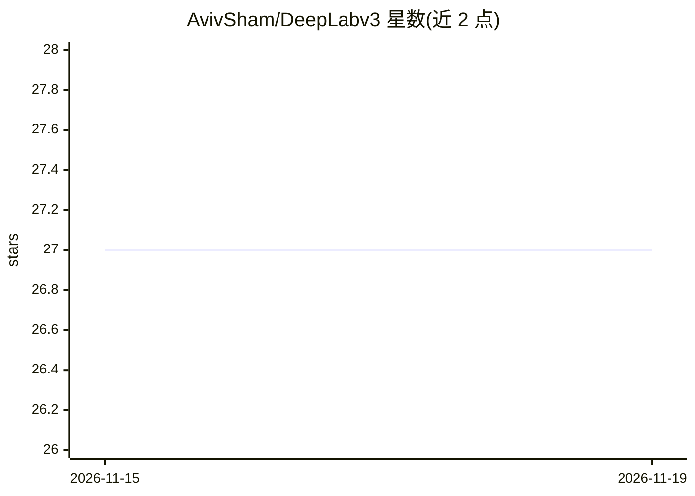

# AvivSham/DeepLabv3

⭐ 27 · Jupyter Notebook · MIT · 推送 2026-11-15 · [GitHub](https://github.com/AvivSham/DeepLabv3) · 个人维护

**DeepLabv3 论文的 PyTorch 复现，用于语义分割训练与测试**

使用 PyTorch 复现 DeepLabv3（Rethinking Atrous Convolutions）论文的语义分割实现，特征提取主干为 ResNet50 或 ResNet101，仓库内含两者的架构代码。提供 Colab notebook 与命令行训练/测试流程：python3 init.py 指定训练集、标签集、类别数即可训练，指定模型与图片即可测试；附带脚本下载 Cityscapes 与 PASCAL VOC 2012 数据集。README 提及将发布 pretrained models，Results 部分列有 Pascal VOC 2012 与 CityScapes 条目。

## 筛选速览

| 维度 | 判定 | 备注 |
|---|---|---|
| AI 角色 | `ai-native` | 本体是模型或模型工具 |
| 许可风险 | `permissive` | MIT |
| 部署形态 | `None` |  |
| 模型依赖 | — | README 未给出锁定关系 |
| 硬件要求 | — | 无带数字的原话,不猜 |
| 安装摩擦 | `medium` | 含编译或系统依赖之一 |
| 成熟度 | — | 结构信号不足 |

## 能力要点

- DeepLabv3 的 PyTorch 实现，主干为 ResNet50/ResNet101
- CLI 训练与测试：python3 init.py 指定数据与类别数
- 附带 Cityscapes 与 PASCAL VOC 2012 数据集下载脚本
- 提供 Colab notebook

## 适用场景

- 我在自己的数据集上训练 DeepLabv3 语义分割模型
- 在 Colab 上跑通论文复现流程
- 用 Cityscapes/PASCAL VOC 做语义分割实验

## 场景标签

`目标检测` · 领域:感知与多模态

## 证据(README 行号)

> L3: In this repository we reproduce the DeepLabv3 paper which can be found here: Rethinking Atrous Convolutions
> L4: The DeepLabv3 model expects the feature extracting architecture to be ResNet50 or ResNet101 so this repository will 

## 星数曲线

2026-11-15 27 → 2026-11-19 27（+0）

---
*卡片 v1 · prompt 1.4 · 生成 2026-11-18 · 置信度 high · 依据 README sha `fd05fe17dd90` · [字段定义](../../DATASET.md)*
