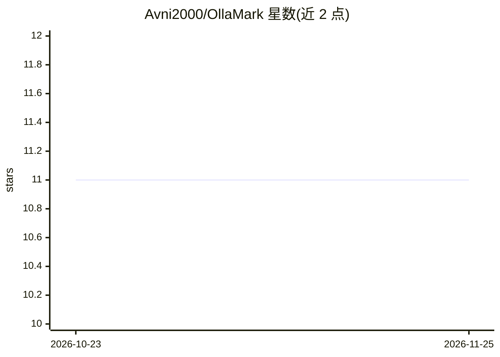

# Avni2000/OllaMark

⭐ 11 · TypeScript · GPL-3.0 · 推送 2026-01-08 · [GitHub](https://github.com/Avni2000/OllaMark) · 个人维护

**基于本地 Ollama 的 Obsidian Markdown 格式化插件**

Obsidian 插件：选中文本后通过热键或右键菜单调用本地 Ollama 实例对 Markdown 做格式化处理，全部处理在本机完成、无需 API key。功能包括内联 diff 视图（逐条接受或拒绝修改）、自定义自然语言提示、热键预设命令（加标题、精简文本、转列表、仅修语法、改善段落流）。可配置 Ollama URL 与模型，默认指向 http://localhost:11434，也支持远程 Ollama 地址。非内容生成器，仅整理已有文本。不支持移动端。

## 筛选速览

| 维度 | 判定 | 备注 |
|---|---|---|
| AI 角色 | `ai-enhanced` | 去掉 AI 部分产品仍成立 |
| 许可风险 | `viral` | GPL-3.0 |
| 部署形态 | `library` | 以包/库形式分发 |
| 模型依赖 | local-ok | 支持本地模型 |
| 硬件要求 | — | 无带数字的原话,不猜 |
| 安装摩擦 | `low` | 无编译、无系统依赖或容器化 |
| 成熟度 | — | 结构信号不足 |

## 能力要点

- 调用本地 Ollama 实例，完全离线处理，无遥测与云端处理
- 内联 diff 视图，逐条接受或拒绝修改建议
- 自定义提示与热键预设命令（标题/精简/列表/语法/段落）
- 可配置 Ollama URL，支持远程实例

## 适用场景

- 整理 Obsidian 笔记中粗糙的 Markdown 格式
- 本地隐私优先环境下美化已写文本
- 用自然语言描述格式要求处理选中段落

## 场景标签

`AI 写作` · 领域:内容生成

## 证据(README 行号)

> L7: I *hate* formatting text in markdown and making it look pretty. It takes forever. So what if I build you an extensio
> L21: 3. Prettify rough text with local Ollama instance
> L38: - **Completely offline**: All processing happens on your machine via Ollama

## 星数曲线

2026-10-23 11 → 2026-11-25 11（+0）

---
*卡片 v1 · prompt 1.4 · 生成 2026-11-19 · 置信度 mid · 依据 README sha `ccbc715c9936` · [字段定义](../../DATASET.md)*
