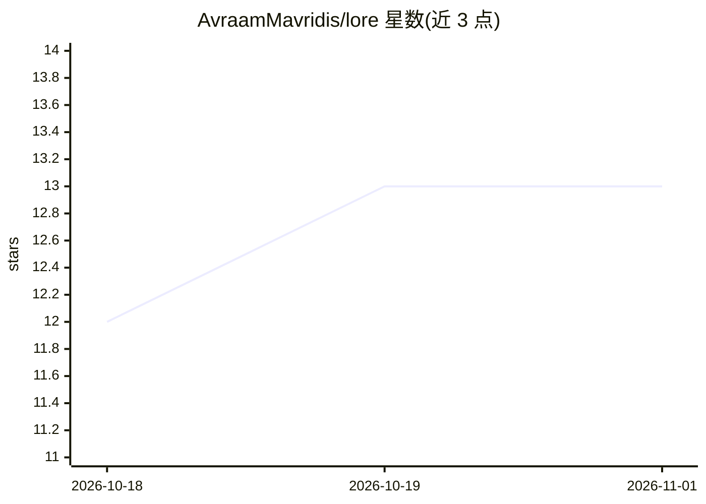

# AvraamMavridis/lore

⭐ 13 · Rust · MIT · 推送 2026-06-17 · [GitHub](https://github.com/AvraamMavridis/lore) · [官网](https://avraammavridis.github.io/lore/) · 个人维护

**记录代码变更背后推理过程的开源 CLI 工具，供人与 AI agent 查询**

Lore 是一个用 Rust 编写的命令行工具，在 Git 之上存储每次代码变更的意图、完整推理链（可达数千词）、被否决的备选方案与标签，条目以哈希链接到文件内容并可关联 Git 提交。多分支冲突采用 append-only 合并策略，保留双方推理记录。面向使用 AI 编码助手的开发者，提供 Claude Code 与 Cursor 的配置集成方式；macOS/Linux/Windows 提供预编译二进制，也可用 cargo 从源码构建。

## 筛选速览

| 维度 | 判定 | 备注 |
|---|---|---|
| AI 角色 | `ai-ecosystem` | LLM/agent 周边工具 |
| 许可风险 | `permissive` | MIT |
| 部署形态 | `desktop` | 安装包/桌面程序 |
| 模型依赖 | — | README 未给出锁定关系 |
| 硬件要求 | — | 无带数字的原话,不猜 |
| 安装摩擦 | `low` | 无编译、无系统依赖或容器化 |
| 成熟度 | — | 结构信号不足 |

## 能力要点

- 以哈希链接方式存储变更意图、完整推理链与被否决的备选方案
- append-only 合并策略保留多分支冲突下的全部推理记录
- lore search 支持按关键词、文件、agent 检索历史推理
- 提供 Claude Code（CLAUDE.md）与 Cursor（.cursorrules）集成配置

## 适用场景

- 团队沉淀每次代码变更的决策原因与踩坑记录
- AI 编码助手改文件前读取隐藏上下文，完成任务后写入推理记录
- 多 agent 协作时避免重复探索已被否决的方案

## 场景标签

`知识库管理` · 领域:知识与检索

## 证据(README 行号)

> L113: ## Integration with AI Agents

## 星数曲线

2026-10-18 12 → 2026-11-01 13（+1）

---
*卡片 v1 · prompt 1.4 · 生成 2026-10-31 · 置信度 high · 依据 README sha `ab10b2f046bd` · [字段定义](../../DATASET.md)*
