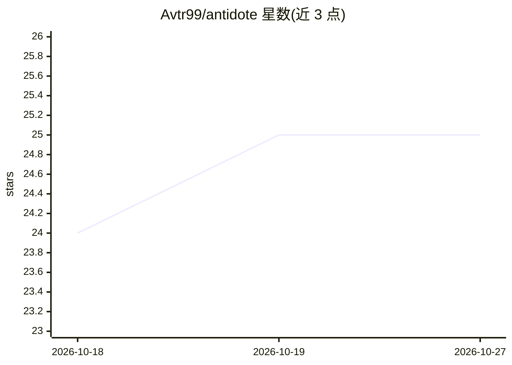

# Avtr99/antidote

⭐ 25 · JavaScript · MIT · 推送 2026-10-15 · [GitHub](https://github.com/Avtr99/antidote) · 个人维护

**约束 AI 编码代理修复根因而非打补丁的 Agent 技能**

一个纯提示词的 Agent Skill（SKILL.md 格式），在 AI 代理写码或审查代码时激活，引导其在边界处一次性校验、使用正确类型/schema、删除损坏路径，替代散布的防御性补丁。提供 fix（单 bug）与 audit（整库）两种模式。附 skill-eval-harness 基准：五个模型开启技能后结构化修复通过率 44%-56%。通过 npx skills add 或各代理插件市场安装，支持 Claude Code、Codex、Cursor、Devin、Copilot 等；无脚本、无网络调用、无依赖。

## 筛选速览

| 维度 | 判定 | 备注 |
|---|---|---|
| AI 角色 | `ai-ecosystem` | LLM/agent 周边工具 |
| 许可风险 | `permissive` | MIT |
| 部署形态 | `library` | 以包/库形式分发 |
| 模型依赖 | — | README 未给出锁定关系 |
| 硬件要求 | — | 无带数字的原话,不猜 |
| 安装摩擦 | `low` | 无编译、无系统依赖或容器化 |
| 成熟度 | — | 结构信号不足 |

## 能力要点

- 纯提示词技能：无脚本、无网络调用、无依赖
- fix 与 audit 双模式，可通过斜杠命令或自然语言调用
- 遵循开放 Agent Skills 标准，适配多代理的本地技能目录
- 附五模型基准测试（skill-eval-harness，含复现命令）

## 适用场景

- 阻止 AI 代理用 null 检查等创可贴式补丁掩盖 bug
- 对整个代码库做过度防御式代码审计
- 在多个 AI 编码平台上统一注入根因修复规则

## 场景标签

`提示工程` · 领域:Agent 开发

## 证据(README 行号)

> L139: |`skills/antidote/SKILL.md`|The skill — the prompt that the agent reads|
> L161: `antidote` is a pure-prompt skill. It has no scripts, no network calls, and no dependencies. It works in any agent

## 星数曲线

2026-10-18 24 → 2026-10-27 25（+1）

---
*卡片 v1 · prompt 1.4 · 生成 2026-10-27 · 置信度 high · 依据 README sha `7e9302995313` · [字段定义](../../DATASET.md)*
