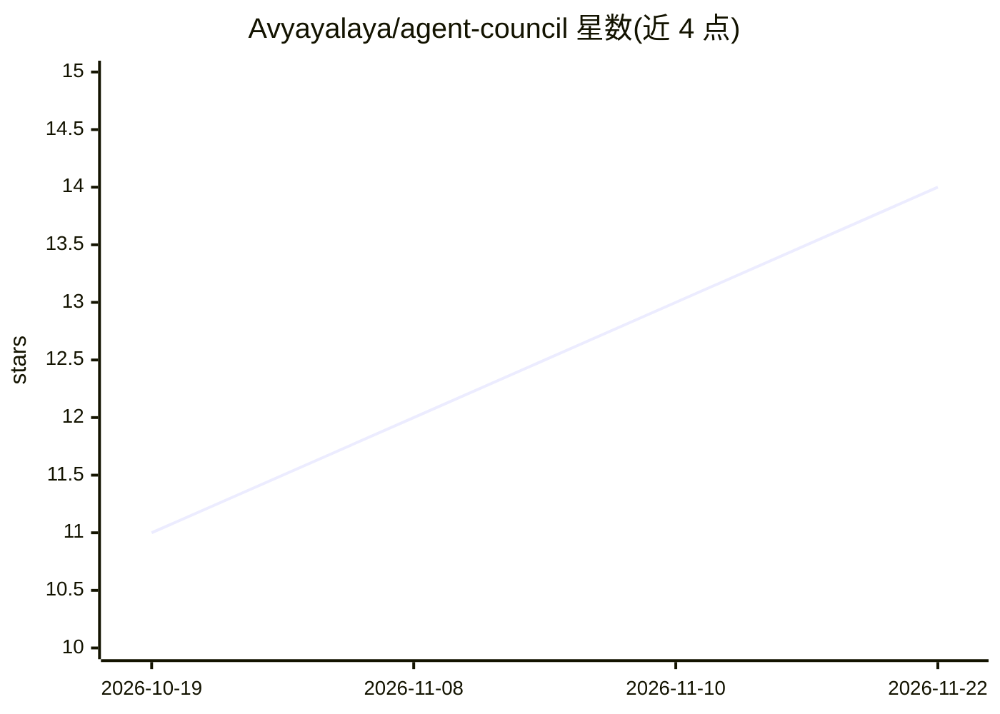

# Avyayalaya/agent-council

⭐ 14 · Python · MIT · 推送 2026-11-05 · [GitHub](https://github.com/Avyayalaya/agent-council) · [官网](https://avyayalaya.github.io/agent-council/) · 个人维护

**五 agent 评审委员会：为文本产物做多视角质量把关**

一个运行时可移植的文本评审门：四个独立评审角色（Skeptic/Voice/Evidence/Strategy）先做首轮独立审阅，再交叉阅读全部首轮结论做第二轮，另一个独立 Adjudicator 综合两轮结果给出建议；代码强制执行最终 SHIP/REVISE/HOLD/INCOMPLETE 判定，模型建议不能绕过策略。核心包无需 SDK 或 API key，通过配置的 CLI（claude/ollama）、LM Studio HTTP 服务或离线 mock 调用模型。提供 Claude Code 插件、pip 源码安装的 Python CLI、MCP 服务器及 APM Skills 四种使用面。

## 筛选速览

| 维度 | 判定 | 备注 |
|---|---|---|
| AI 角色 | `ai-native` | 本体是模型或模型工具 |
| 许可风险 | `permissive` | MIT |
| 部署形态 | `library` | 以包/库形式分发 |
| 模型依赖 | local-ok | 支持本地模型 |
| 硬件要求 | — | 无带数字的原话,不猜 |
| 安装摩擦 | `low` | 无编译、无系统依赖或容器化 |
| 成熟度 | — | 结构信号不足 |

## 能力要点

- 两轮评审加独立裁决的协议，代码强制执行判定策略
- JSONL 审计日志与归档 transcript 记录每次运行
- 核心包无必需 SDK 或 API key，支持离线 mock 运行
- 按 tier 规则对产物分级，仅 tier-1 走委员会评审

## 适用场景

- 发布前对公开文章、README 等重要文本做多角色评审
- 在 CI/管道中以 MCP 工具形式做产物质量门禁
- 编辑文档时逐个调用评审 Skill 获取单视角反馈

## 场景标签

`多智能体` · 领域:Agent 开发

## 证据(README 行号)

> L10: A runtime-portable review gate for text you write, AI generates, or you create together. Skeptic, Evidence, Voice, 
> L12: No required SDK or API key in the core package. Runtime adapters use a configured CLI (`claude`, `ollama`), LM Stud
> L79: |Run full automated Council on an artifact with parallel deliberators + 2-round cross-read + JSONL audit|`python -m

## 星数曲线

2026-10-19 11 → 2026-11-22 14（+3）

---
*卡片 v1 · prompt 1.4 · 生成 2026-11-18 · 置信度 high · 依据 README sha `f2e8726d46eb` · [字段定义](../../DATASET.md)*
