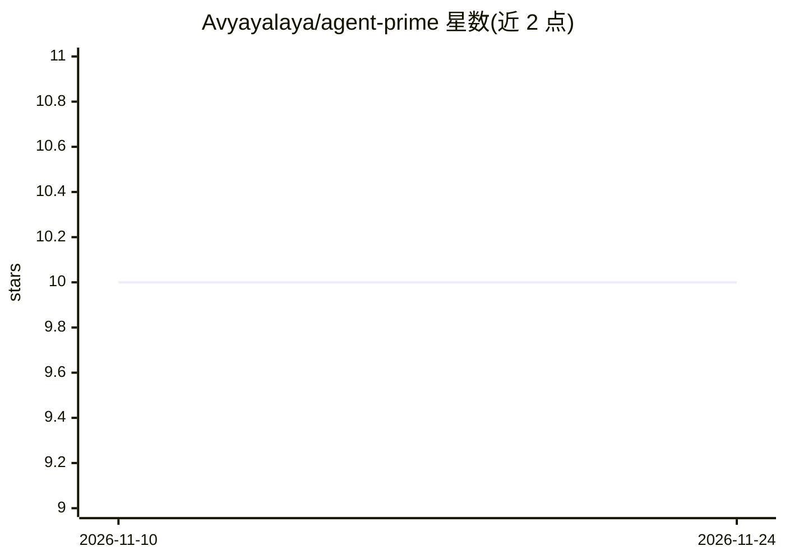

# Avyayalaya/agent-prime

⭐ 10 · HTML · MIT · 推送 2026-05-19 · [GitHub](https://github.com/Avyayalaya/agent-prime) · [官网](https://avyayalaya.github.io/agent-prime/) · 个人维护

**纯 markdown 构建的持久化多 Agent 系统提示框架**

由 markdown 文件构成的持久化 AI 工作系统：7 个架构层、13 个专职 agent、12 个 PM 方法论技能、8 条 guardrails、4 个工作流，以及递归改进循环——每次会话中的纠正被写入持久规则并跨 agent 传播。安装方式为 git clone 后由 Claude Code 自动读取 CLAUDE.md，或由 GitHub Copilot 自动注入指令文件；提供 Python 交互式初始化与校验脚本；声明零依赖、模型无关，也可手动加载到任意 LLM。

## 筛选速览

| 维度 | 判定 | 备注 |
|---|---|---|
| AI 角色 | `ai-ecosystem` | LLM/agent 周边工具 |
| 许可风险 | `permissive` | MIT |
| 部署形态 | `None` |  |
| 模型依赖 | locked-api |  |
| 硬件要求 | — | 无带数字的原话,不猜 |
| 安装摩擦 | `low` | 无编译、无系统依赖或容器化 |
| 成熟度 | — | 结构信号不足 |

## 能力要点

- 13 个专职 agent 与 5-agent 质量门（agent-council）
- 纠错即持久规则的记忆层（100+ learnings）
- 纯 markdown、零依赖、模型无关
- 支持 Claude Code 自动加载与 Copilot 自动注入

## 适用场景

- 一句话输入跑出完整产品策略/行业分析文档流水线
- 让跨会话的纠错与设计标准持续沉淀复用
- 在 Claude Code 之外的 LLM 环境手动加载同一套 agent 提示

## 场景标签

`Agent 框架` `多智能体` `提示工程` `工作流自动化` · 领域:Agent 开发

## 证据(README 行号)

> L3: **A persistent AI operating system built entirely from markdown files.**
> L133: The system prompt file is the same regardless of model. Agents, skills, and memory are model-agnostic.

## 星数曲线

2026-11-10 10 → 2026-11-24 10（+0）

---
*卡片 v1 · prompt 1.4 · 生成 2026-11-20 · 置信度 high · 依据 README sha `f3809be39b67` · [字段定义](../../DATASET.md)*
