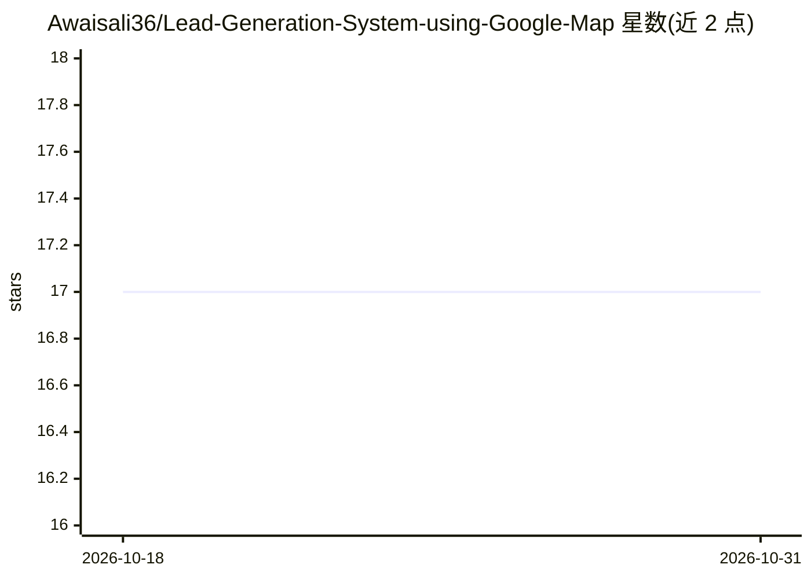

# Awaisali36/Lead-Generation-System-using-Google-Map

⭐ 17 · MIT · 推送 2026-04-23 · [GitHub](https://github.com/Awaisali36/Lead-Generation-System-using-Google-Map) · 个人维护

**对话式 AI agent：从 Google Maps 抓取并富集商业销售线索**

由两个 n8n 工作流 JSON 文件构成的对话式线索挖掘系统：用户以自然语言下达指令，GPT-4o agent 解析意图后经 Serper.dev Google Maps API 搜索商户、自动分页抓取名称/地址/电话/评分等字段并写入 Google Sheets；子工作流由表格触发，Perplexity AI（Sonar）逐条查找联系邮箱与公司背景并回写，全程无需人工干预。面向销售、电话销售与 B2B 机构。需自备 n8n 实例及 OpenAI/Serper/Perplexity API key，安装方式为导入工作流文件并配置凭据。

## 筛选速览

| 维度 | 判定 | 备注 |
|---|---|---|
| AI 角色 | `ai-native` | 本体是模型或模型工具 |
| 许可风险 | `permissive` | MIT |
| 部署形态 | `None` |  |
| 模型依赖 | — | README 未给出锁定关系 |
| 硬件要求 | — | 无带数字的原话,不猜 |
| 安装摩擦 | `low` | 无编译、无系统依赖或容器化 |
| 成熟度 | — | 结构信号不足 |

## 能力要点

- GPT-4o 自然语言驱动的商户搜索与分页抓取，写入 Google Sheets
- Perplexity AI 自动富集邮箱与公司背景（每条约 5-10 秒）
- 两阶段工作流：抓取保存与自动富集分离，全程自动
- 线索带 UUID 去重跟踪，输出 CRM 就绪格式

## 适用场景

- 用自然语言按地点和行业批量拉取潜在客户名单
- 为电话销售获取商户电话等联系方式
- 邮件营销前自动补全客户邮箱与公司背景

## 场景标签

`网页抓取` `工作流自动化` `聊天机器人` · 领域:效率与自动化

## 证据(README 行号)

> L8: > **Conversational AI agent that extracts and enriches business leads from Google Maps through natural language chat
> L30: - 🧠 **AI-Powered Understanding** - GPT-4o interprets your requests intelligently
> L124: |**AI Agent**|OpenAI GPT-4o|Natural language understanding and task execution|

## 星数曲线

2026-10-18 17 → 2026-10-31 17（+0）

---
*卡片 v1 · prompt 1.4 · 生成 2026-10-30 · 置信度 high · 依据 README sha `42871c690310` · [字段定义](../../DATASET.md)*
