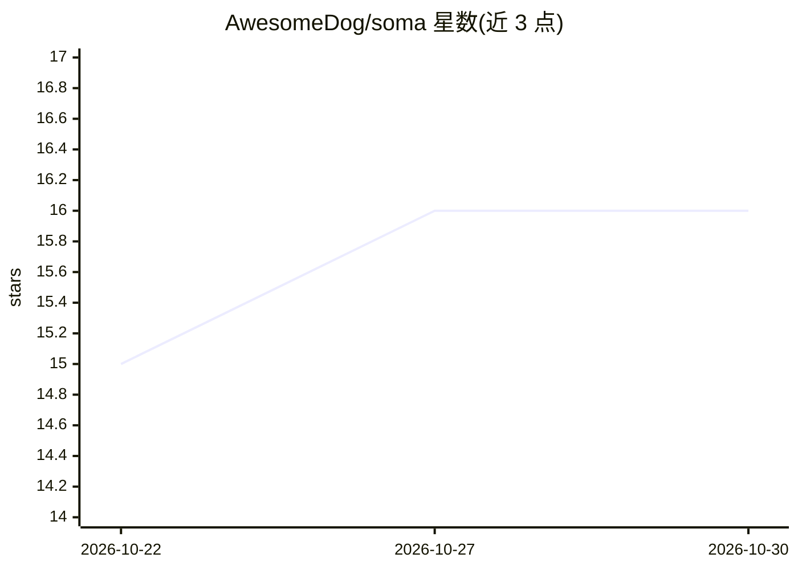

# AwesomeDog/soma

⭐ 16 · Java · MIT · 推送 2026-10-26 · [GitHub](https://github.com/AwesomeDog/soma) · [官网](https://awesomedog.github.io/soma/) · 个人维护

**本地优先的文件语义搜索引擎：离线索引文档与多媒体**

面向个人与团队的单二进制本地知识库搜索引擎：对指定文件夹中的 Markdown、PDF、Office/EPUB、图片、音视频做本地索引（SQLite 存储），通过本地运行的模型生成语义向量并支持 BM25 词法、向量、HyDE 三种检索模式，混合模式经 RRF 融合与本地 LLM 重排。提供 CLI、内置 Web UI 与镜像 CLI 的 HTTP API，输出 JSON/CSV/Markdown。全程离线、无 API key；多媒体功能运行时需 24GB 以上内存，HTTP 服务默认无鉴权仅监听 127.0.0.1。

## 筛选速览

| 维度 | 判定 | 备注 |
|---|---|---|
| AI 角色 | `ai-native` | 本体是模型或模型工具 |
| 许可风险 | `permissive` | MIT |
| 部署形态 | `library` | 以包/库形式分发 |
| 模型依赖 | — | README 未给出锁定关系 |
| 硬件要求 | `cpu-ok` | |
| 安装摩擦 | `medium` | 含编译或系统依赖之一 |
| 成熟度 | — | 结构信号不足 |

## 能力要点

- BM25 + 向量 + HyDE 混合检索，RRF 融合与本地 LLM 重排
- 本地模型（EmbeddingGemma、Qwen3、Whisper，经 llama.cpp/whisperfile 运行于 CPU 或 GPU）
- 单文件 GraalVM 原生二进制，覆盖 Windows x64 / macOS ARM64 / Linux x64
- 支持气隙安装：模型与工具导出为 ZIP 后离线导入

## 适用场景

- 对 Obsidian/笔记库/PDF 论文库做自然语言语义搜索
- 在代码库中按含义查找内部文档与逻辑位置
- 音视频转写与图片 OCR 后统一检索
- 作为 AI agent 的本地 RAG 检索后端（JSON 输出 + HTTP API）

## 场景标签

`语义搜索` `知识库管理` `文档解析` · 领域:知识与检索

## 证据(README 行号)

> L18: uses **locally running AI models** to build a *semantic fingerprint* of every file — the model's understanding of w
> L46: - 🧠 **Understands meaning, not just strings** — local LLM query expansion, dense embeddings, HyDE, and an LLM reran
> L62: |**Local models only**|EmbeddingGemma, Qwen3 reranker, Qwen3-VL, Whisper — all run through `llama.cpp` / `whisperfi

## 星数曲线

2026-10-22 15 → 2026-10-30 16（+1）

---
*卡片 v1 · prompt 1.4 · 生成 2026-10-30 · 置信度 high · 依据 README sha `bac96e8226cd` · [字段定义](../../DATASET.md)*
