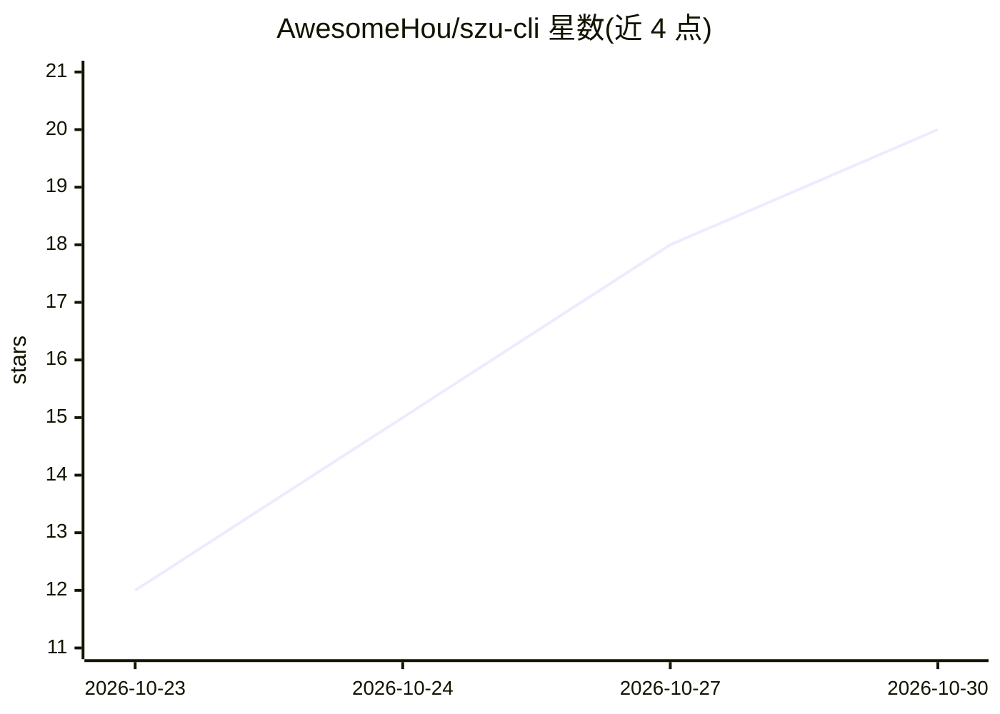

# AwesomeHou/szu-cli

⭐ 20 · JavaScript · MIT · 推送 2026-10-24 · [GitHub](https://github.com/AwesomeHou/szu-cli) · 个人维护 · 中文 README

**深圳大学校园网页服务的 agent 友好 CLI 与 Skill**

面向深圳大学网页服务的非官方命令行工具：将公文通公告、个人与全校课表、成绩 GPA、讲座、体育场馆预约、宿舍电费、图书馆馆藏、知网/万方论文检索等校园事务封装为稳定命令，默认输出结构化 JSON。登录态通过 Playwright 持久化浏览器 profile 复用，不保存账号密码；支持 Chrome/Edge/Chromium。可同时安装供 Codex、Claude Code、Cursor 等 Agent 使用的 Skill。状态变更命令须 --dry-run 与显式 --confirm。

## 筛选速览

| 维度 | 判定 | 备注 |
|---|---|---|
| AI 角色 | `ai-ecosystem` | LLM/agent 周边工具 |
| 许可风险 | `permissive` | MIT |
| 部署形态 | `library` | 以包/库形式分发 |
| 模型依赖 | — | README 未给出锁定关系 |
| 硬件要求 | — | 无带数字的原话,不猜 |
| 安装摩擦 | `low` | 无编译、无系统依赖或容器化 |
| 成熟度 | — | 结构信号不足 |

## 能力要点

- 校园网页能力封装为 CLI 命令并默认输出结构化 JSON
- 复用本机持久化浏览器登录态，不收集账号密码
- Skill 可安装到 Codex、Claude Code、Cursor 等主流 Agent
- 状态变更命令默认只读优先，须 --dry-run 与显式 --confirm

## 适用场景

- 查询课表、成绩、GPA 与毕业学分进度
- 搜索图书馆馆藏及知网/万方论文元数据
- 预约体育场馆并查询宿舍电费
- 让 AI Agent 通过 Skill 调用 CLI 代办校园事务

## 场景标签

`浏览器自动化` · 领域:效率与自动化

## 证据(README 行号)

> L8: `szu-cli` 是面向深圳大学网页服务的 agent-friendly CLI。
> L29: > 2. 从当前 npm 包自带的 `skills/szu-cli-skill` 安装文件，通过 `npx skills add` 将 Skill 全局安装到当前环境中可识别的主流 AI Agent。
> L31: > 支持的 Agent 及其项目级、全局 skill 目录请参阅 Supported Agents，包括 Codex、Claude Code、Cursor 等。WorkBuddy 用户安装 CLI 后，可运行 `szu-cli s

## 星数曲线

2026-10-23 12 → 2026-10-30 20（+8）

---
*卡片 v1 · prompt 1.4 · 生成 2026-10-29 · 置信度 high · 依据 README sha `ea48e5f5552f` · [字段定义](../../DATASET.md)*
