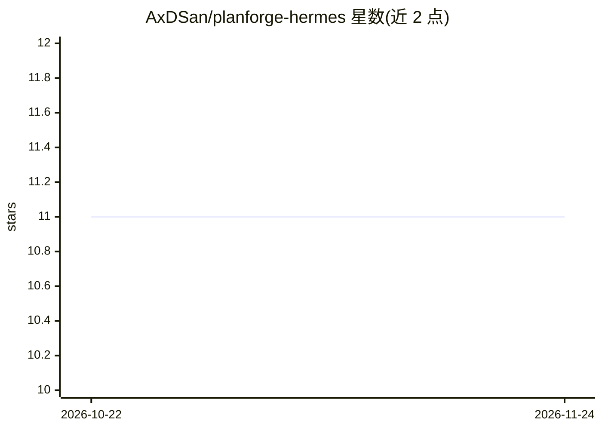

# AxDSan/planforge-hermes

⭐ 11 · Python · MIT · 推送 2026-05-05 · [GitHub](https://github.com/AxDSan/planforge-hermes) · 个人维护

**Hermes Agent 的规格驱动开发规划插件**

面向 Hermes Agent 的插件，将项目拆分为阶段化计划并通过 .planning/ 文件落地，任务以 XML 结构定义依赖与验收标准。提供 /planforge-* 系列斜杠命令完成初始化、规划、执行、验证与创建 PR，通过 Hermes 的 delegate_task 实现阶段内并行执行，并注册 pre_tool_call 等 hooks 在关键阶段暂停 agent。计划可在 Telegram、Discord、Slack 或 CLI 使用，Web 仪表盘新增 Roadmap 标签页展示进度。

## 筛选速览

| 维度 | 判定 | 备注 |
|---|---|---|
| AI 角色 | `ai-ecosystem` | LLM/agent 周边工具 |
| 许可风险 | `permissive` | MIT |
| 部署形态 | `None` |  |
| 模型依赖 | — | README 未给出锁定关系 |
| 硬件要求 | — | 无带数字的原话,不猜 |
| 安装摩擦 | `low` | 无编译、无系统依赖或容器化 |
| 成熟度 | — | 结构信号不足 |

## 能力要点

- 阶段化规划与入口/出口条件验证门
- 状态全部存于 .planning/ 文件，可版本控制与迁移
- 经 delegate_task 在阶段内并行执行任务
- 注册 Hermes 插件 hooks（pre_tool_call/transform_tool_result 等）

## 适用场景

- 把高层项目愿景拆解为可执行的开发任务
- 为 agent 执行流程加入阶段验证与追溯
- 从 Telegram/Discord/Slack/CLI 管理开发计划

## 场景标签

`编码 Agent` · 领域:编码与开发

## 证据(README 行号)

> L3: A spec-driven development planning plugin for Hermes Agent, inspired by GSD (Get Shit Done) and fully compatible wit
> L13: PlanForge is **not** a replacement for Hermes' agentic capabilities. It is a **force multiplier** — adding structur

## 星数曲线

2026-10-22 11 → 2026-11-24 11（+0）

---
*卡片 v1 · prompt 1.4 · 生成 2026-11-19 · 置信度 high · 依据 README sha `3ef3bd0c760d` · [字段定义](../../DATASET.md)*
