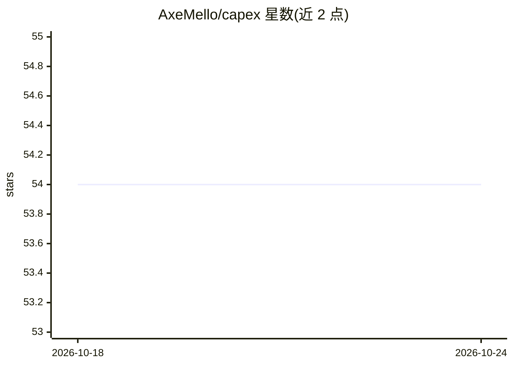

# AxeMello/capex

⭐ 54 · HTML · MIT · 推送 2026-02-05 · [GitHub](https://github.com/AxeMello/capex) · 个人维护

**Flutter 文档扫描 App：拍照 OCR 并结构化写入 Google Sheets**

基于 Flutter 的移动应用：用设备相机拍摄最多 4 页文档照片，通过 Google ML Kit 在设备端做 OCR 文字识别，再将合并后的文本经 AI 解析为结构化 JSON 字段，写入通过服务账户授权的 Google Sheets 电子表格。应用内置 Sheets 查看器，可列出表格、查看数据、刷新、浏览器打开及删除表格。使用需自备 Flutter SDK、Android SDK、Google Cloud 项目及服务账户密钥，并在代码中配置目标 spreadsheetId。

## 筛选速览

| 维度 | 判定 | 备注 |
|---|---|---|
| AI 角色 | `ai-native` | 本体是模型或模型工具 |
| 许可风险 | `permissive` | MIT |
| 部署形态 | `None` |  |
| 模型依赖 | — | README 未给出锁定关系 |
| 硬件要求 | — | 无带数字的原话,不猜 |
| 安装摩擦 | `low` | 无编译、无系统依赖或容器化 |
| 成熟度 | — | 结构信号不足 |

## 能力要点

- 单次扫描最多 4 页照片的多页采集
- Google ML Kit 设备端 OCR 文字识别
- OCR 文本解析为结构化 JSON 字段
- 通过服务账户写入 Google Sheets 并内置查看器

## 适用场景

- 用手机拍照扫描票据或单据并自动录入表格
- 在应用内浏览和管理已导出的扫描结果
- 多页文档一次扫描后集中写入电子表格

## 场景标签

`OCR` `文档解析` · 领域:知识与检索

## 证据(README 行号)

> L3: A Flutter mobile app that scans documents with the device camera, extracts text via on-device OCR (Google ML Kit), p
> L8: - **On-device OCR**: text extraction using **Google ML Kit**
> L9: - **AI parsing**: converts OCR text into structured JSON (see `lib/ai_parser.dart`)

## 星数曲线

2026-10-18 54 → 2026-10-24 54（+0）

---
*卡片 v1 · prompt 1.4 · 生成 2026-10-24 · 置信度 high · 依据 README sha `22c091f274da` · [字段定义](../../DATASET.md)*
