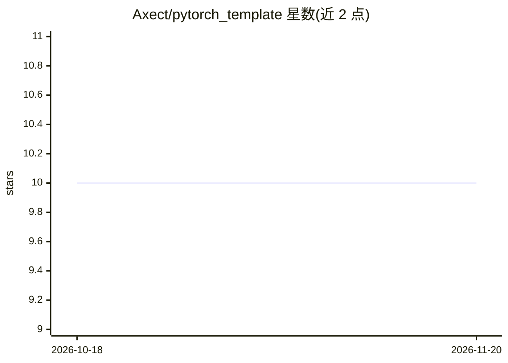

# Axect/pytorch_template

⭐ 10 · Python · MIT · 推送 2026-05-06 · [GitHub](https://github.com/Axect/pytorch_template) · [官网](https://axect.github.io/pytorch_template) · 个人维护

**研究者用 YAML 驱动的 PyTorch 实验流水线模板**

基于 PyTorch 2.7+ 的配置驱动研究模板：一份 YAML 配置覆盖训练、预检、Optuna 超参搜索与监控。训练循环采用回调架构（NaN 检测、过拟合检测、剪枝、检查点等 12 个内置回调），记录双通道（W&B 或 TUI）并始终保存 CSV 与最新模型。附带 Rust 编写的终端 TUI 监控器实时渲染损失曲线，以及面向 Claude Code/Codex/Forge 的 agent skills，可自动配置实验与迁移旧项目。CLI 通过 python -m cli 调用。

## 筛选速览

| 维度 | 判定 | 备注 |
|---|---|---|
| AI 角色 | `ai-ecosystem` | LLM/agent 周边工具 |
| 许可风险 | `permissive` | MIT |
| 部署形态 | `None` |  |
| 模型依赖 | — | README 未给出锁定关系 |
| 硬件要求 | — | 无带数字的原话,不猜 |
| 安装摩擦 | `high` | 编译与系统依赖俱全 |
| 成熟度 | — | 结构信号不足 |

## 能力要点

- 一份 YAML 配置驱动预检、训练、Optuna HPO 与监控
- 12 个优先级排序的回调，可子类扩展训练循环
- Rust TUI 监控器从 CSV 实时渲染损失曲线（1.2 MB 静态二进制）
- 内置 agent skills，支持安装到 Claude/Codex/Forge

## 适用场景

- 管理 PyTorch 研究实验的配置、训练与复现
- 用 Optuna 做超参搜索并实时监控试验进展
- 让 AI agent 按编码的领域知识自动配置实验
- 在无 W&B 环境下通过 TUI 与 CSV 追踪训练

## 场景标签

`MLOps` · 领域:训练与推理

## 证据(README 行号)

> L14: *Config-driven experiment pipeline with dual logging, real-time TUI monitor, and AI agent skills.*
> L195: ## AI-Assisted Training (Agent Skills)

## 星数曲线

2026-10-18 10 → 2026-11-20 10（+0）

---
*卡片 v1 · prompt 1.4 · 生成 2026-11-20 · 置信度 high · 依据 README sha `639948d49037` · [字段定义](../../DATASET.md)*
