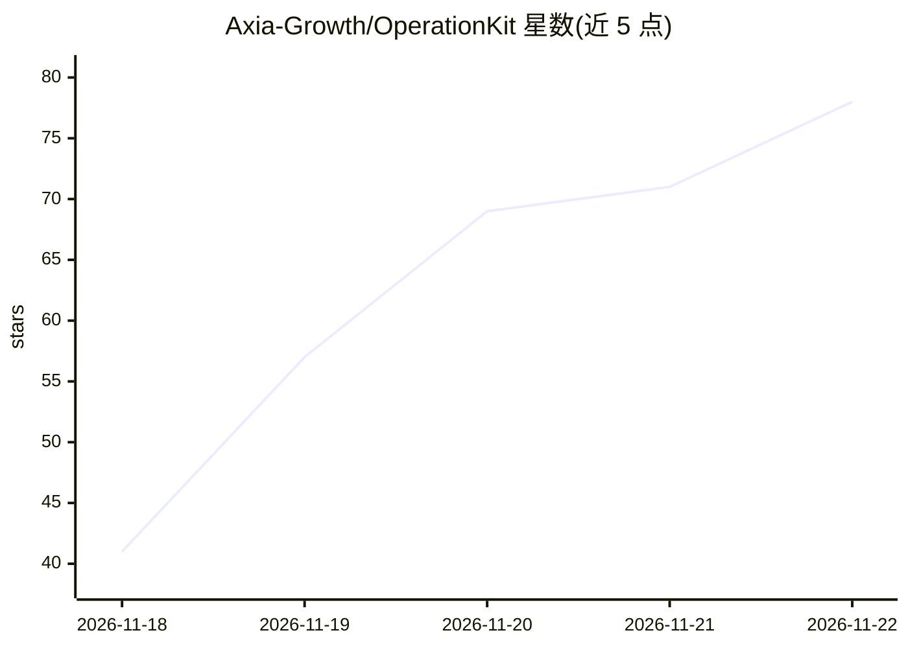

# Axia-Growth/OperationKit

⭐ 78 · TypeScript · Apache-2.0 · 推送 2026-11-20 · [GitHub](https://github.com/Axia-Growth/OperationKit) · [官网](https://operationkit.com) · 组织维护

**给企业/顾问的自托管 AI 落地基座：知识库+任务板+MCP 接入**

面向 AI 实施顾问的自托管基础设施：在客户自有服务器上安装一套私有 Web 应用，包含基于自有文档的知识库（回答带来源引用、夜间清理矛盾与过时内容）、以卡片形式运行编码 agent 的任务板（默认 Claude Code，支持 Codex 与 Grok，含独立 AI 审查）、可选的持久化 bot 对话，以及通过 MCP 与受限密钥让 Claude、ChatGPT、Grok 等应用接入同一知识库。每个客户独立安装，无共享云；agent、技能与知识库为服务器上的纯文件，可切换模型供应商。Apache-2.0 许可。

## 筛选速览

| 维度 | 判定 | 备注 |
|---|---|---|
| AI 角色 | `ai-native` | 本体是模型或模型工具 |
| 许可风险 | `permissive` | Apache-2.0 |
| 部署形态 | `None` |  |
| 模型依赖 | locked-api |  |
| 硬件要求 | — | 无带数字的原话,不猜 |
| 安装摩擦 | `low` | 无编译、无系统依赖或容器化 |
| 成熟度 | — | 结构信号不足 |

## 能力要点

- 知识库：导入 Excel/CSV/PDF/Word 及聊天导出，编译为可问答的 markdown 页面，回答引用来源
- AI 工人任务板：每卡片在独立沙箱运行编码 agent，独立 AI 审查后由人签收
- MCP 接入：Claude、ChatGPT、Grok、Cursor 等以具名受限密钥共用同一知识库与任务板
- 每客户端独立安装、数据不出客户服务器，agent 与知识库为纯文件、无模型锁定

## 适用场景

- 顾问为每个客户快速部署一套私有 AI 知识库与 agent 平台
- 企业把耗时任务变成卡片交给沙箱中的编码 agent 执行并审查
- 让团队已有的 Claude/ChatGPT/Grok 等应用通过 MCP 复用内部知识库

## 场景标签

`文档问答` `编码 Agent` · 领域:编码与开发

## 证据(README 行号)

> L9: app with a knowledge base of their own documents, AI workers that run jobs as cards on a board, an
> L31: |**Knowledge base**|Drop in Excel, CSV, PDF and Word files; they become organized, linked notes you can ask questio
> L32: |**AI workers on a board**|Anything that takes more than a few minutes becomes a card: *queue → working → review → 
> L34: |**Connect any AI app (MCP)**|Claude, ChatGPT, Grok, Codex, Cursor and other MCP apps connect with a named, limited

## 星数曲线

2026-11-18 41 → 2026-11-22 78（+37）

---
*卡片 v1 · prompt 1.4 · 生成 2026-11-18 · 置信度 high · 依据 README sha `21e5eed7ff0f` · [字段定义](../../DATASET.md)*
