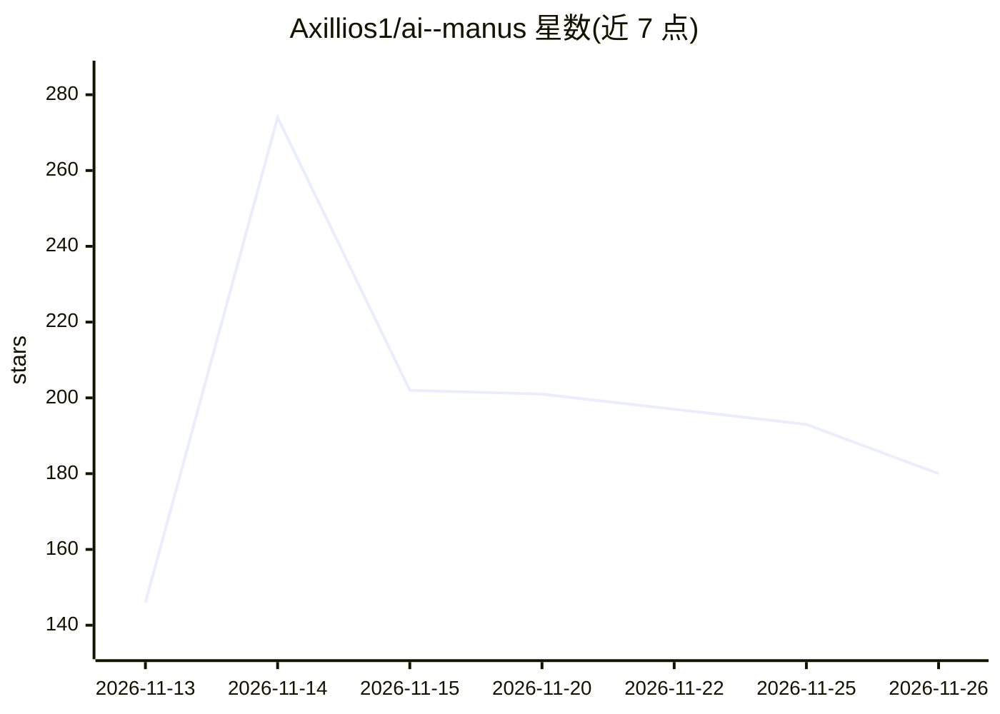

# Axillios1/ai--manus

⭐ 180 · Apache-2.0 · 推送 2026-11-14 · [GitHub](https://github.com/Axillios1/ai--manus) · 个人维护

**面向个人用户的自主 AI Agent：代为执行代码与浏览器操作**

Manus 是一个自主运行的 AI agent，定位为执行代码与控制浏览器的通用助手：用户以自然语言下达任务，agent 自行编写并执行脚本、打开网页、填写表单、完成多步骤工作。README 面向家庭、学习与轻办公场景的用户描述，强调无需编程背景。兼容性章节列出最低双核 CPU、4 GB 内存的系统要求。README 未提供安装命令、仓库结构或技术实现细节，仅有下载链接与推广码，内容以功能宣传为主。

## 筛选速览

| 维度 | 判定 | 备注 |
|---|---|---|
| AI 角色 | `ai-native` | 本体是模型或模型工具 |
| 许可风险 | `permissive` | Apache-2.0 |
| 部署形态 | `None` |  |
| 模型依赖 | — | README 未给出锁定关系 |
| 硬件要求 | — | 无带数字的原话,不猜 |
| 安装摩擦 | `low` | 无编译、无系统依赖或容器化 |
| 成熟度 | — | 结构信号不足 |

## 能力要点

- 自主执行代码：agent 自行编写并运行脚本完成任务
- 浏览器控制：自动导航网页、填表、采集信息
- 代码与浏览器操作可在同一任务流中衔接
- 跨会话保持任务模式，减少重复说明

## 适用场景

- 让学生整理研究资料、跑小脚本
- 让 agent 代为浏览多个网页收集信息并汇总
- 处理日常重复性小任务（文件检查、表单填写）

## 场景标签

`编码 Agent` `浏览器自动化` `AI 助手` · 领域:效率与自动化

## 证据(README 行号)

> L18: Manus is an autonomous AI agent designed to run code and control a browser on your behalf. Instead of acting like a
> L10: - **Autonomous Code Execution:** Manus AI agent runs code on its own to complete tasks, so you can focus on decisio

## 星数曲线

2026-11-13 146 → 2026-11-26 180（+34）

---
*卡片 v1 · prompt 1.4 · 生成 2026-11-17 · 置信度 mid · 依据 README sha `4347b4dd3fa7` · [字段定义](../../DATASET.md)*
