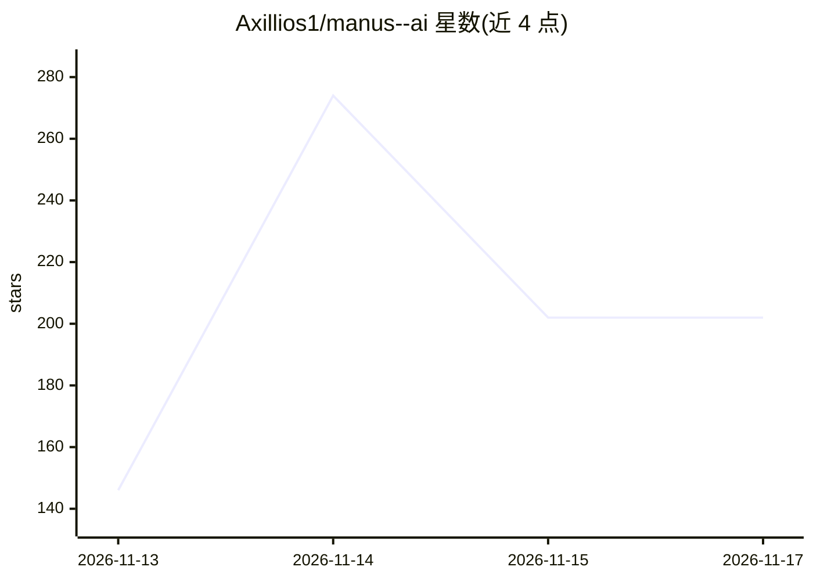

# Axillios1/manus--ai

⭐ 202 · Apache-2.0 · 推送 2026-11-14 · [GitHub](https://github.com/Axillios1/manus--ai) · 个人维护

**自主 AI Agent：替用户执行代码与控制浏览器完成多步任务**

面向家庭、学习与轻量办公场景的自主 AI 代理：用户用自然语言描述需求，代理自行编写并执行脚本、打开网页、与页面元素交互、执行多步任务，可跨脚本与浏览器衔接完成流程，并在会话间复用已学到的任务模式。README 声明其定位为小型任务的专注助手而非企业平台，目标用户包括学生、远程工作者与同时处理多个小项目的用户。README 提供硬件兼容表（最低 4GB 内存、双核 CPU）与使用步骤说明，但未给出具体的安装命令、下载渠道细节或模型接入方式。

## 筛选速览

| 维度 | 判定 | 备注 |
|---|---|---|
| AI 角色 | `ai-native` | 本体是模型或模型工具 |
| 许可风险 | `permissive` | Apache-2.0 |
| 部署形态 | `None` |  |
| 模型依赖 | — | README 未给出锁定关系 |
| 硬件要求 | — | 无带数字的原话,不猜 |
| 安装摩擦 | `low` | 无编译、无系统依赖或容器化 |
| 成熟度 | — | 结构信号不足 |

## 能力要点

- 自主编写并执行代码完成任务
- 浏览器控制：导航网页、填写表单、采集信息
- 脚本与浏览器动作在同一任务流中衔接
- 跨会话记住任务模式并重复应用

## 适用场景

- 让代理代为查网页、填表单、整理研究资料
- 不写代码的情况下运行小脚本和快速计算
- 把重复性的日常小任务委托给后台代理

## 场景标签

`浏览器自动化` `编码 Agent` `AI 助手` · 领域:效率与自动化

## 证据(README 行号)

> L10: - **Autonomous Code Execution:** Manus AI agent runs code on its own to complete tasks, so you can focus on decisio
> L18: Manus is an autonomous AI agent designed to run code and control a browser on your behalf. Instead of acting like a

## 星数曲线

2026-11-13 146 → 2026-11-17 202（+56）

---
*卡片 v1 · prompt 1.4 · 生成 2026-11-17 · 置信度 mid · 依据 README sha `4347b4dd3fa7` · [字段定义](../../DATASET.md)*
