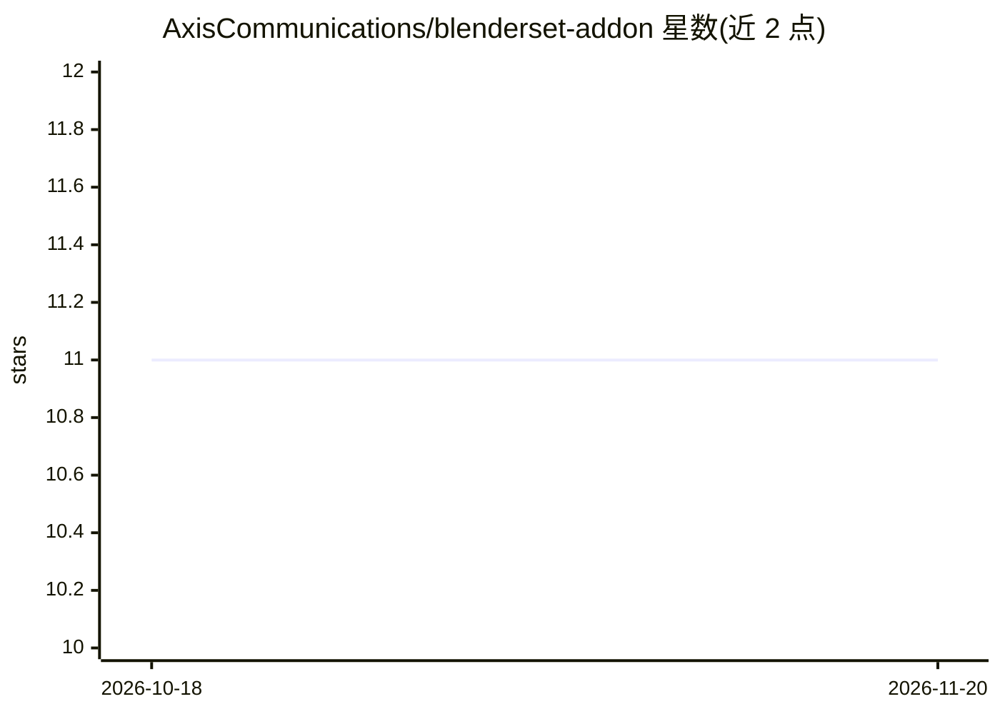

# AxisCommunications/blenderset-addon

⭐ 11 · Python · MIT · 推送 2026-11-18 · [GitHub](https://github.com/AxisCommunications/blenderset-addon) · 组织维护

**用 Blender 生成合成训练数据（图像+标注）的插件**

以 Blender 插件形式运行的数据生成工具：在真实背景图上随机放置行人与车辆 3D 模型并施加随机 HDRI 光照后渲染，同时生成逐像素实例分割与边界框标注。支持真实或合成地面背景、可配置资产与元数据目录，人形模型可来自 Reallusion 或 BEDLAM 数据集。安装需克隆源码、初始化虚拟环境并安装 OpenEXR/FFmpeg 相关系统依赖，通过 make 命令与 GUI 操作。

## 筛选速览

| 维度 | 判定 | 备注 |
|---|---|---|
| AI 角色 | `ai-native` | 本体是模型或模型工具 |
| 许可风险 | `permissive` | MIT |
| 部署形态 | `None` |  |
| 模型依赖 | — | README 未给出锁定关系 |
| 硬件要求 | — | 无带数字的原话,不猜 |
| 安装摩擦 | `low` | 无编译、无系统依赖或容器化 |
| 成熟度 | — | 结构信号不足 |

## 能力要点

- 渲染随机场景并生成逐像素实例分割与边界框标注
- 支持真实背景图或 Polyhaven 下载材质的合成背景
- HDRI 光照与随机行人/车辆模型放置
- 人形资产支持 Reallusion 与 BEDLAM 数据集流程

## 适用场景

- 为行人/车辆检测与分割模型生成带标注的训练数据
- 在难以采集的真实场景上合成随机样本
- 用 BEDLAM 或 Reallusion 人物模型扩充数据集

## 场景标签

`目标检测` · 领域:感知与多模态

## 证据(README 行号)

> L3: Blenderset is tool for creating synthetic training data using blender. It can be used
> L6: rendered images, annotations are generated in form of pixelwise

## 星数曲线

2026-10-18 11 → 2026-11-20 11（+0）

---
*卡片 v1 · prompt 1.4 · 生成 2026-11-19 · 置信度 high · 依据 README sha `6e21e4b1647f` · [字段定义](../../DATASET.md)*
