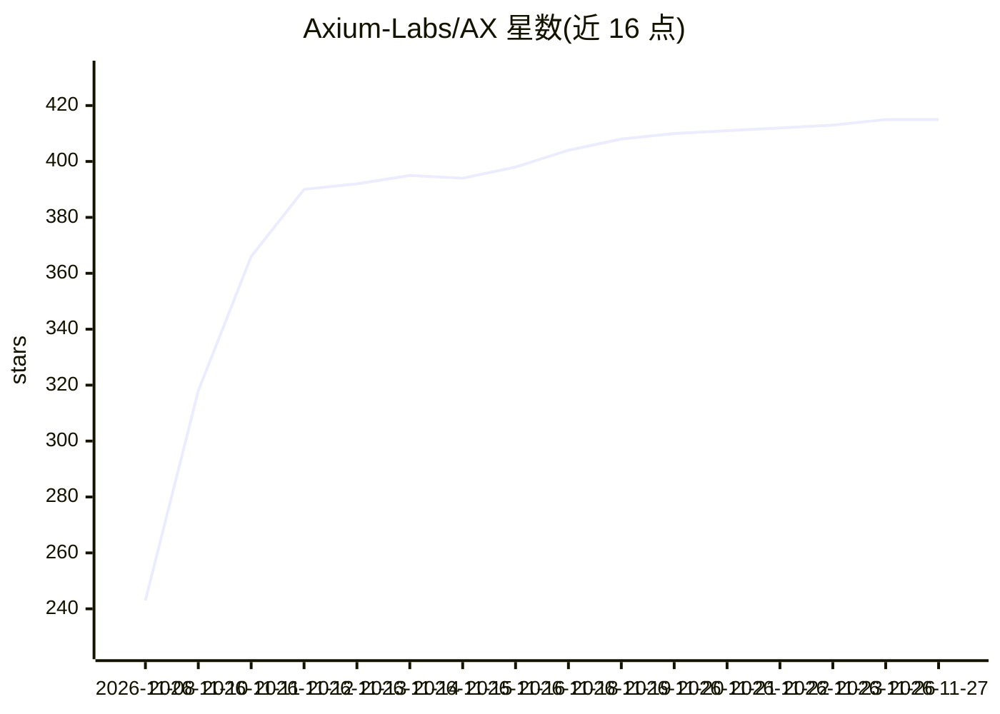

# Axium-Labs/AX

⭐ 415 · Rust · Apache-2.0 · 推送 2026-11-05 · [GitHub](https://github.com/Axium-Labs/AX) · [官网](https://axium.ax-labs.workers.dev/) · 组织维护 · 中文 README

**Rust 编写的本地优先终端 AI 代理，支持多提供商模型**

以 Rust 构建的原生终端 AI 代理，单一二进制文件运行于 Windows/Linux/macOS。用户通过 /login 接入 OpenAI Codex（OAuth）、DeepSeek、OpenAI 及 OpenAI 兼容厂商（Groq、Mistral、OpenRouter 等），用 /model 切换模型。会话、记忆、凭据与模型配置存储在本机 .ax 目录，无遥测。提供 SKILL.md 技能包、按需加载的 MCP 服务器、只读网页搜索、原生图像输入；支持非交互运行与并发多任务，可经 ACP 暴露给客户端或接入 AX Crew 控制面。核心用无需 Node 或 Docker，可选 Browser Use 需 Node 与 Playwright。

## 筛选速览

| 维度 | 判定 | 备注 |
|---|---|---|
| AI 角色 | `ai-native` | 本体是模型或模型工具 |
| 许可风险 | `permissive` | Apache-2.0 |
| 部署形态 | `desktop` | 安装包/桌面程序 |
| 模型依赖 | locked-api |  |
| 硬件要求 | — | 无带数字的原话,不猜 |
| 安装摩擦 | `medium` | 含编译或系统依赖之一 |
| 成熟度 | — | 结构信号不足 |

## 能力要点

- 单一 Rust 二进制，核心使用无需 Node/Docker
- 支持 Codex OAuth、DeepSeek、OpenAI 及 OpenAI 兼容厂商并动态发现模型
- SKILL.md 技能包、MCP 服务器、记忆与提供商按需加载
- 会话/记忆/凭据本地存储，ax export/import 提供可迁移备份

## 适用场景

- 在终端里与多家提供商的模型对话并随时切换
- 非交互执行单次任务或并发运行多个代理任务
- 不注册远端服务、数据留在本机的本地优先 AI 使用方式

## 场景标签

`AI 助手` · 领域:对话与助手

## 证据(README 行号)

> L3: A fast, lightweight AI agent for the terminal, built in Rust.
> L15: AX is a small, native terminal agent. It starts fast, streams responses, and
> L31: - **Simple workflow** — type, get an answer, switch models, move on.

## 星数曲线

2026-11-08 243 → 2026-11-27 415（+172）

---
*卡片 v1 · prompt 1.4 · 生成 2026-11-17 · 置信度 high · 依据 README sha `8b314cc43958` · [字段定义](../../DATASET.md)*
