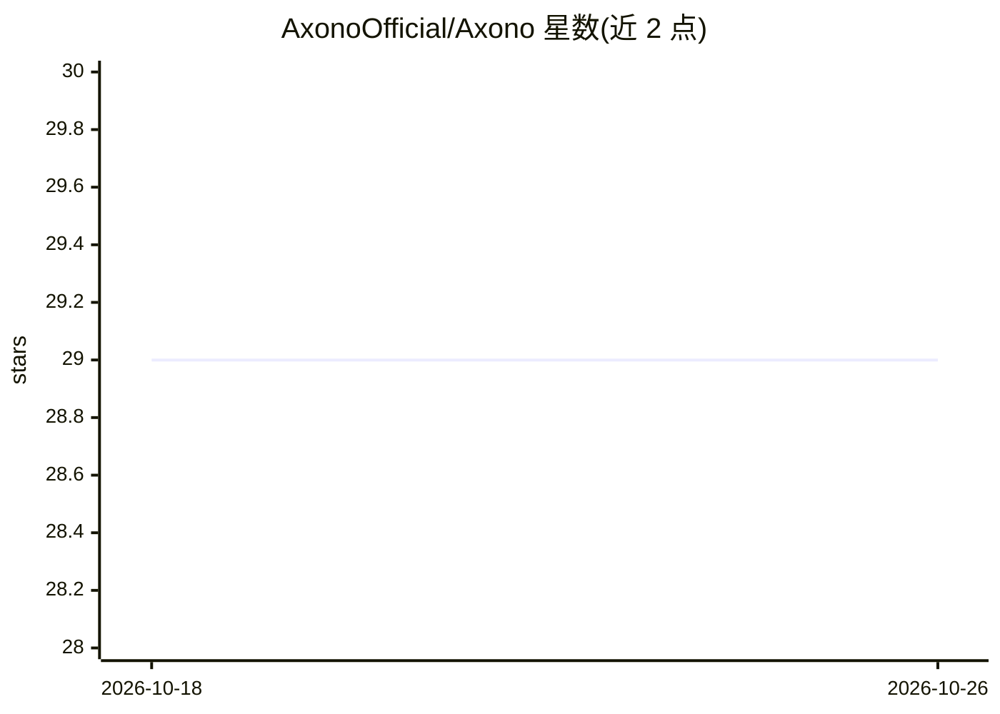

# AxonoOfficial/Axono

⭐ 29 · Python · Apache-2.0 · 推送 2026-10-16 · [GitHub](https://github.com/AxonoOfficial/Axono) · [官网](https://axono.org) · 组织维护 · 中文 README

**轻量级张量/算子与推理库，面向教学、研究与原型开发**

Axono 是一个 Python/C++ 的人工智能算法库，提供张量抽象（零拷贝 NumPy 互操作、多种数据精度）、nn 模块系统（Linear/LayerNorm/RMSNorm、compile 计算图优化、FP16 混合推理）、LLM 算子（SDPA/GQA/RoPE/KV Cache/flash-decoding）与自定义 AXM1 权重格式（memmap 零拷贝）。支持 CPU（OpenBLAS+OpenMP）与 NVIDIA GPU（cuBLASLt、CUDAGraph、caching allocator），内置 Qwen3-VL-2B 复刻的端到端多模态推理示例。安装方式为 Linux/Windows 下源码编译脚本或 pip 安装预构建 wheel，Windows 未做设备测试。

## 筛选速览

| 维度 | 判定 | 备注 |
|---|---|---|
| AI 角色 | `ai-native` | 本体是模型或模型工具 |
| 许可风险 | `permissive` | Apache-2.0 |
| 部署形态 | `library` | 以包/库形式分发 |
| 模型依赖 | — | README 未给出锁定关系 |
| 硬件要求 | — | 无带数字的原话,不猜 |
| 安装摩擦 | `high` | 编译与系统依赖俱全 |
| 成熟度 | — | 结构信号不足 |

## 能力要点

- 张量抽象含零拷贝 NumPy 互操作与 float16↔float32 转换
- 融合算子与 split-K flash-decoding 等推理加速算子
- AXM1 权重格式支持 memmap 零拷贝加载与流式读取
- CPU 与 NVIDIA GPU 双设备支持，纯 CPU 编译选项可用

## 适用场景

- 教学与研究中学习张量/算子底层机制
- 原型开发中构建轻量模型推理流程
- 在 GPU 上加载并运行 Qwen3-VL 等模型做推理实验

## 场景标签

`推理引擎` · 领域:训练与推理

## 证据(README 行号)

> L10: Axono 是一个轻量级的人工智能算法库，旨在为教学、研究与原型开发提供简洁可扩展的张量与算子接口。
> L84: ## 端到端示例：Qwen3-VL-2B 多模态推理

## 星数曲线

2026-10-18 29 → 2026-10-26 29（+0）

---
*卡片 v1 · prompt 1.4 · 生成 2026-10-26 · 置信度 mid · 依据 README sha `ce0c96d9d31e` · [字段定义](../../DATASET.md)*
