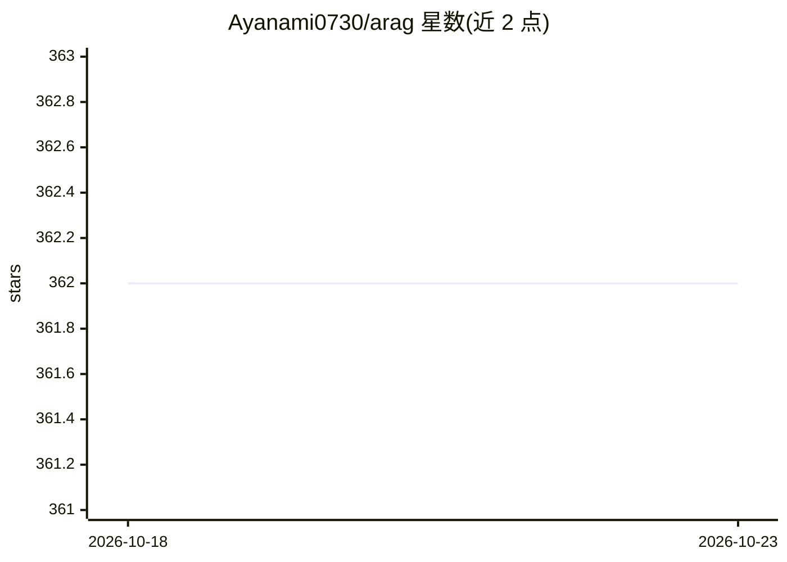

# Ayanami0730/arag

⭐ 362 · Python · 推送 2026-02-06 · [GitHub](https://github.com/Ayanami0730/arag) · [官网](https://agentresearchlab.org/agents/a-rag) · 组织维护

**给研究者的 Agentic RAG 框架：分层检索工具支持多跳问答**

A-RAG 是一个 Agentic RAG 框架，向模型直接暴露分层检索接口：keyword_search（词法匹配、免预索引）、semantic_search（句子级稠密检索、需预建索引）、chunk_read（读取指定及相邻分块并带上下文追踪器），agent 以 ReAct 式循环自主决定检索策略与何时作答。面向 RAG 研究与复现人群，提供评测套件（MuSiQue、HotpotQA 等基准）、Python API 与自定义语料接入。当前仅支持 OpenAI 兼容 API，Anthropic/Gemini 原生支持在 Roadmap 中，配套论文发布于 arXiv。

## 筛选速览

| 维度 | 判定 | 备注 |
|---|---|---|
| AI 角色 | `ai-ecosystem` | LLM/agent 周边工具 |
| 许可风险 | `permissive` | — |
| 部署形态 | `library` | 以包/库形式分发 |
| 模型依赖 | — | README 未给出锁定关系 |
| 硬件要求 | — | 无带数字的原话,不猜 |
| 安装摩擦 | `low` | 无编译、无系统依赖或容器化 |
| 成熟度 | — | 结构信号不足 |

## 能力要点

- 三个分层粒度检索工具：关键词/语义/分块读取
- 自主策略、迭代执行与交错工具使用的 agentic 循环
- 基准评测套件覆盖 MuSiQue、HotpotQA、2WikiMQA、GraphRAG-Bench
- 支持自定义 JSON 语料与 Python API 扩展

## 适用场景

- 在多跳问答基准上运行与复现 agentic RAG 实验
- 用自定义语料构建 agent 驱动的检索问答系统
- 对 RAG 方法做消融与基线对比研究

## 场景标签

`RAG` `模型评测` · 领域:评测与运维

## 证据(README 行号)

> L49: **A-RAG** is an **A**gentic **RAG** framework that exposes **hierarchical retrieval interfaces** directly to the mo
> L115: A-RAG provides three retrieval tools that operate at different granularities:

## 星数曲线

2026-10-18 362 → 2026-10-23 362（+0）

---
*卡片 v1 · prompt 1.4 · 生成 2026-10-21 · 置信度 mid · 依据 README sha `9d6234643401` · [字段定义](../../DATASET.md)*
