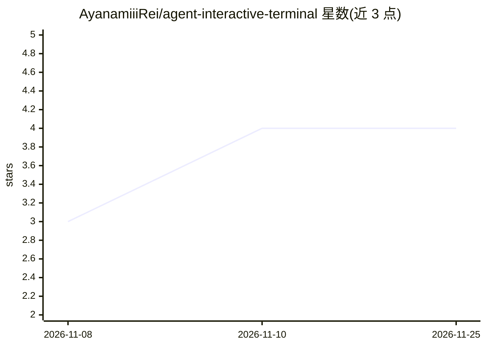

# AyanamiiiRei/agent-interactive-terminal

⭐ 4 · TypeScript · MIT · 推送 2026-11-17 · [GitHub](https://github.com/AyanamiiiRei/agent-interactive-terminal) · 个人维护

**让 LLM agent 与人共享同一终端会话的 PTY 工具**

提供有状态 PTY 终端会话的核心库与两套宿主适配器（DSH 插件与 Codex/ChatGPT MCP 服务器）：模型读取离散屏幕快照而非字节流，提供 8 个 terminal_* 工具，支持键盘租约、协作/只读/密封三级访问、wait 条件与密码人工交接（密码不进入模型上下文）。同一核心也可脱离 agent 框架直接以 TerminalRegistry 使用。需 Node.js 20+ 与编译 node-pty 的 C++ 工具链。

## 筛选速览

| 维度 | 判定 | 备注 |
|---|---|---|
| AI 角色 | `ai-ecosystem` | LLM/agent 周边工具 |
| 许可风险 | `permissive` | MIT |
| 部署形态 | `desktop` | 安装包/桌面程序 |
| 模型依赖 | — | README 未给出锁定关系 |
| 硬件要求 | — | 无带数字的原话,不猜 |
| 安装摩擦 | `low` | 无编译、无系统依赖或容器化 |
| 成熟度 | — | 结构信号不足 |

## 能力要点

- 8 个 terminal_* 工具：open/send/wait/snapshot/key/resize/close/list
- 键盘租约与协作/只读/密封三级访问控制
- 密码人工交接，秘密不进入模型上下文
- DSH 插件与 Codex/ChatGPT MCP 双宿主适配器共享同一核心

## 适用场景

- 让 agent 在真实 TTY 中运行交互式程序和 REPL
- agent 遇到密码提示时暂停并交给人工输入
- 人工随时接管或锁定 agent 正在使用的终端会话

## 场景标签

`Agent 框架` · 领域:Agent 开发

## 证据(README 行号)

> L15: > One shared terminal core with two host adapters: a DeepSeek Harness bundle and a Codex/ChatGPT MCP App. Eight `te
> L21: This project turns a terminal into a resource with identity, a screen, a phase, and a lease. The model reads discre

## 星数曲线

2026-11-08 3 → 2026-11-25 4（+1）

---
*卡片 v1 · prompt 1.4 · 生成 2026-11-21 · 置信度 high · 依据 README sha `e6e185ac48bf` · [字段定义](../../DATASET.md)*
