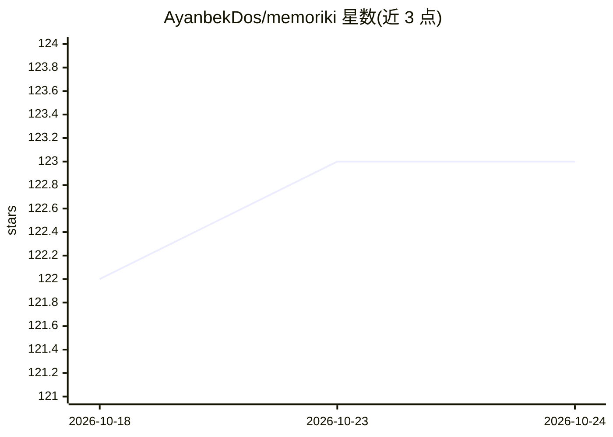

# AyanbekDos/memoriki

⭐ 123 · MIT · 推送 2026-04-14 · [GitHub](https://github.com/AyanbekDos/memoriki) · 个人维护

**个人知识库模板：LLM Wiki 结构 + MemPalace 语义记忆**

结合 Andrej Karpathy 的 LLM Wiki 方法与 MemPalace MCP server 的个人知识库工程：wiki 层由 LLM 维护 Markdown 页面（wiki-links、YAML frontmatter），MemPalace 层通过 mempalace_search 提供全内容语义检索、通过 mempalace_kg_query 查询带时间戳的实体关系图。操作包括摄取（放入 raw/ 由 LLM 整合进 wiki）、提问（LLM 检索并综合回答）与 lint 健康检查。以 git clone 模板形式使用，需配合任意 MCP 兼容的 LLM agent（Claude Code、Codex、Cursor 等）。

## 筛选速览

| 维度 | 判定 | 备注 |
|---|---|---|
| AI 角色 | `ai-ecosystem` | LLM/agent 周边工具 |
| 许可风险 | `permissive` | MIT |
| 部署形态 | `None` |  |
| 模型依赖 | — | README 未给出锁定关系 |
| 硬件要求 | — | 无带数字的原话,不猜 |
| 安装摩擦 | `low` | 无编译、无系统依赖或容器化 |
| 成熟度 | — | 结构信号不足 |

## 能力要点

- 三层结构：Markdown wiki + 语义检索（mempalace_search）+ 实体知识图谱（mempalace_kg_query）
- 通过 MCP 协议与 Claude Code、OpenAI Codex、Cursor、Gemini CLI 等 agent 配合
- Lint 健康检查：矛盾、孤儿页面、知识缺口

## 适用场景

- 创始人集中管理客户访谈、竞品与转型记录
- 研究者维护持续综合的论文与笔记 wiki
- 学生把讲义、书籍整理为结构化的第二大脑
- 团队用 AI 维护会议、决策的团队 wiki

## 场景标签

`知识库管理` `知识图谱` `语义搜索` · 领域:知识与检索

## 证据(README 行号)

> L3: Personal knowledge base with real memory. Combines LLM Wiki (Andrej Karpathy) + MemPalace (MCP server).
> L47: Any MCP-compatible LLM agent:

## 星数曲线

2026-10-18 122 → 2026-10-24 123（+1）

---
*卡片 v1 · prompt 1.4 · 生成 2026-10-23 · 置信度 mid · 依据 README sha `45d84bdf4f3c` · [字段定义](../../DATASET.md)*
