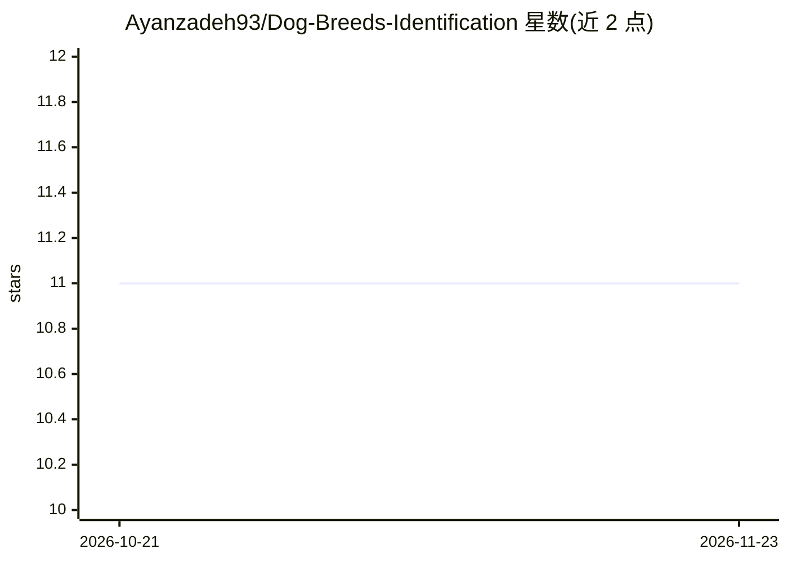

# Ayanzadeh93/Dog-Breeds-Identification

⭐ 11 · Jupyter Notebook · 推送 2026-09-28 · [GitHub](https://github.com/Ayanzadeh93/Dog-Breeds-Identification) · [官网](https://web.itu.edu.tr/ayanzadeh17/) · 个人维护

**Keras/TensorFlow 犬种细粒度图像分类实践项目**

基于 Keras（TensorFlow 后端）构建的犬种识别项目，使用 Kaggle Dog Breed Identification 比赛数据集与 Stanford ImageNet Dogs 数据集，对 120 个犬种做细粒度图像分类。README 给出 Linux/macOS/Windows 的依赖安装指引（Anaconda、pip 安装 Keras、TensorFlow 安装链接），GPU 运行需另装 CUDA 8.0，训练日志通过 TensorBoard 查看。脚本作者标注可能不稳定，并有配套预印本论文。

## 筛选速览

| 维度 | 判定 | 备注 |
|---|---|---|
| AI 角色 | `ai-native` | 本体是模型或模型工具 |
| 许可风险 | `none` | — |
| 部署形态 | `library` | 以包/库形式分发 |
| 模型依赖 | — | README 未给出锁定关系 |
| 硬件要求 | — | 无带数字的原话,不猜 |
| 安装摩擦 | `medium` | 含编译或系统依赖之一 |
| 成熟度 | — | 结构信号不足 |

## 能力要点

- 支持 Kaggle 与 Stanford 两套犬种图像数据集
- 提供 Linux/macOS/Windows 三平台依赖安装指引
- 关联预印本论文（Preprints 2018, doi 已给出）
- 训练日志支持 TensorBoard 查看

## 适用场景

- 练习细粒度图像分类（120 类犬种识别）
- 学习 Keras/TensorFlow 图像分类流程
- 复现犬种识别相关论文实验

## 场景标签

`目标检测` `教程课程` · 领域:学习与行业

## 证据(README 行号)

> L9: "data" is a well seperated dataset (including labels information) for images from stanford dataset http://vision.sta
> L13: In this project Keras library with Tensorflow Backend is used. Thus, in order to run the code successfully, first, 
> L17: #### Ayanzadeh, A.; Vahidnia, S.. Modified Deep Neural Networks for Dog Breeds Identification. Preprints 2018, 2018

## 星数曲线

2026-10-21 11 → 2026-11-23 11（+0）

---
*卡片 v1 · prompt 1.4 · 生成 2026-11-19 · 置信度 mid · 依据 README sha `e2e71cf68d5a` · [字段定义](../../DATASET.md)*
