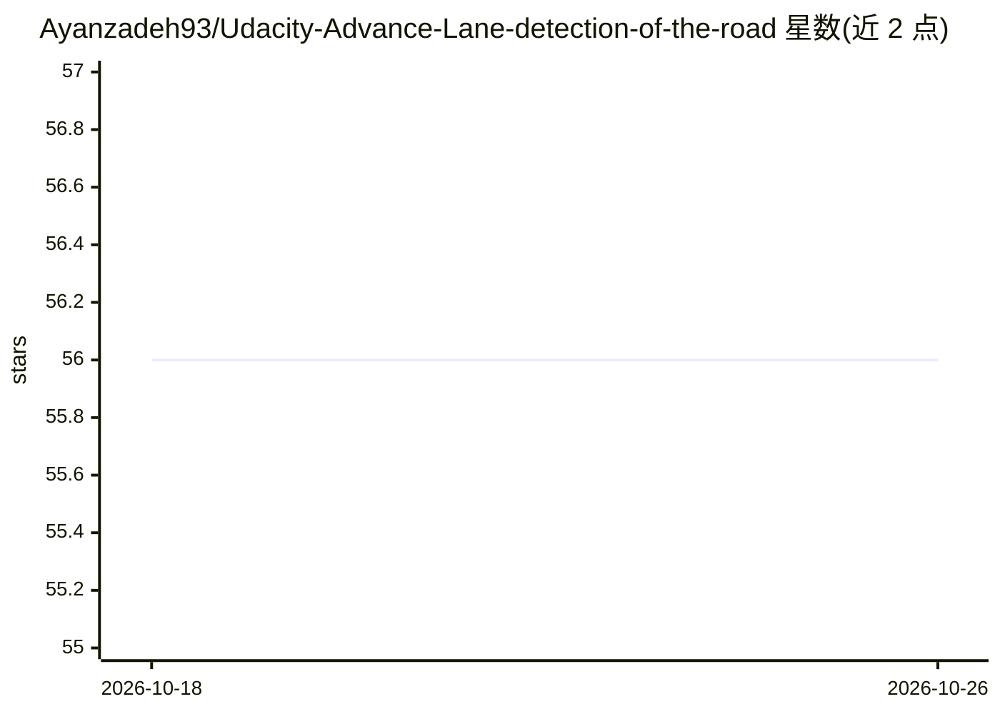

# Ayanzadeh93/Udacity-Advance-Lane-detection-of-the-road

⭐ 56 · Python · 推送 2026-09-28 · [GitHub](https://github.com/Ayanzadeh93/Udacity-Advance-Lane-detection-of-the-road) · [官网](https://web.itu.edu.tr/ayanzadeh17/) · 个人维护

**Udacity 自动驾驶课程的车道线检测项目（OpenCV 流水线）**

Udacity 自动驾驶汽车工程师纳米学位的 Advanced Lane Finding 课程项目：对车载摄像头视频应用计算机视觉技术，检测道路车道线并输出车道曲率半径与车辆偏离中心的偏移量。流水线包括棋盘格相机标定与畸变校正、Sobel 梯度与颜色空间的阈值二值化、透视变换（含消失点估计的自动计算）、车道像素多项式拟合。基于 Python 3 与 OpenCV 实现，数据为 Udacity 提供的行车视频。

## 筛选速览

| 维度 | 判定 | 备注 |
|---|---|---|
| AI 角色 | `ai-native` | 本体是模型或模型工具 |
| 许可风险 | `none` | — |
| 部署形态 | `library` | 以包/库形式分发 |
| 模型依赖 | — | README 未给出锁定关系 |
| 硬件要求 | — | 无带数字的原话,不猜 |
| 安装摩擦 | `low` | 无编译、无系统依赖或容器化 |
| 成熟度 | — | 结构信号不足 |

## 能力要点

- 棋盘格图像的相机标定与畸变校正
- 消失点最小二乘估计自动构建透视变换（鸟瞰图）
- 阈值二值化（Sobel 梯度/HLS）与车道多项式拟合
- 输出车道曲率半径与车辆中心偏移的数值估计

## 适用场景

- 学习自动驾驶课程中的车道检测计算机视觉流水线
- 对 Udacity 行车视频做车道线检测与可视化
- 参考相机标定与透视变换的实现方法

## 场景标签

`教程课程` · 领域:学习与行业

## 证据(README 行号)

> L7: In this Advanced Lane Detection project, we apply computer vision techniques to augment video output with a detected
> L13: * Use color transforms, gradients, etc., to create a thresholded binary image.
> L15: * Detect lane pixels and fit to find the lane boundary.

## 星数曲线

2026-10-18 56 → 2026-10-26 56（+0）

---
*卡片 v1 · prompt 1.4 · 生成 2026-10-24 · 置信度 mid · 依据 README sha `78cb79ef5892` · [字段定义](../../DATASET.md)*
