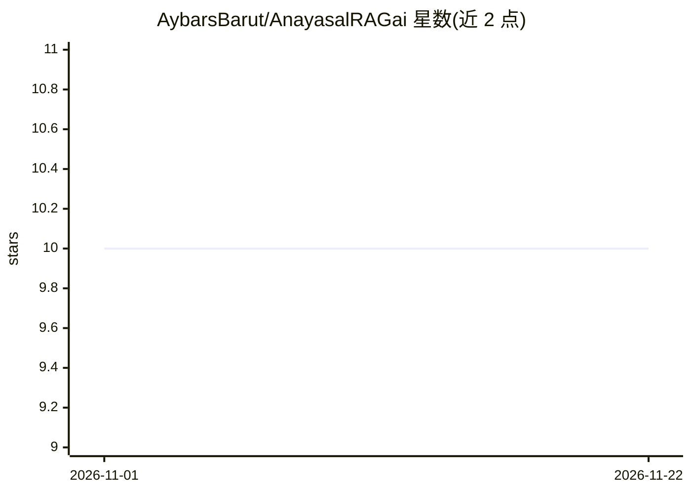

# AybarsBarut/AnayasalRAGai

⭐ 10 · Python · MIT · 推送 2026-05-19 · [GitHub](https://github.com/AybarsBarut/AnayasalRAGai) · [官网](https://aybarsbarut.com) · 个人维护

**面向土耳其宪法的本地 RAG 问答助手（FastAPI+Ollama）**

基于土耳其宪法的检索增强生成系统，提供 FastAPI 后端与静态前端：混合关键词/向量检索（ChromaDB）、结构化 Markdown/JSON 法律数据、带来源引用与置信度标签的回答，以及宪法合规风险审查端点（/api/v1/analyze，输出风险等级与信号）。面向 AI 开发者、legaltech 开发者、土耳其法研究者与学生。本地优先运行，依赖 Ollama 与 llama3 模型；README 明确声明不产生法律建议。

## 筛选速览

| 维度 | 判定 | 备注 |
|---|---|---|
| AI 角色 | `ai-native` | 本体是模型或模型工具 |
| 许可风险 | `permissive` | MIT |
| 部署形态 | `self-host` | docker 或自建部署 |
| 模型依赖 | local-ok | 支持本地模型 |
| 硬件要求 | — | 无带数字的原话,不猜 |
| 安装摩擦 | `low` | 无编译、无系统依赖或容器化 |
| 成熟度 | — | 结构信号不足 |

## 能力要点

- 混合关键词与向量检索，ChromaDB 持久化索引
- 回答带来源引用、confidence 分级（verified/source_grounded/needs_review）
- 宪法合规风险审查端点：风险等级、信号与 reviewer notes
- 提供 Docker Compose、Makefile、评估脚本、unit test 与 CI 起点

## 适用场景

- 就土耳其宪法条文做基于来源的问答
- 将政策草案或事件描述对照宪法做风险审查
- 作为土耳其 NLP/legal RAG 管线的参考项目

## 场景标签

`RAG` `文档问答` `语义搜索` `科研工具` · 领域:知识与检索

## 证据(README 行号)

> L5: **AnayasalRAGai - Turkish Constitution RAG Assistant** is a Retrieval-Augmented Generation system focused on the Con
> L22: - FastAPI backend foundation for legal question answering.
> L51: - `backend/rag.py`: RAG pipeline, retriever, prompt ve doğrulama akışı.

## 星数曲线

2026-11-01 10 → 2026-11-22 10（+0）

---
*卡片 v1 · prompt 1.4 · 生成 2026-11-20 · 置信度 high · 依据 README sha `e1b1b0a252c2` · [字段定义](../../DATASET.md)*
