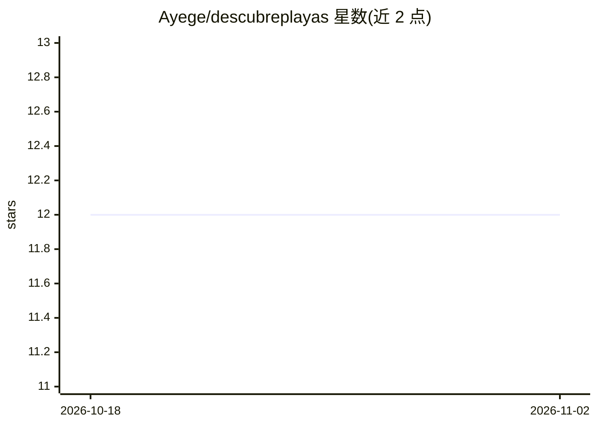

# Ayege/descubreplayas

⭐ 12 · Python · Apache-2.0 · 推送 2026-09-21 · [GitHub](https://github.com/Ayege/descubreplayas) · [官网](https://descubreplayas.com.do/) · 个人维护

**多米加海藻预警系统：卫星检测马尾藻并预测到岸时间**

面向多米尼加共和国沿海用户的马尾藻监测预警系统（POC）：通过 Google Earth Engine 对 Sentinel-2 影像计算浮藻指数（FAI）检测漂浮马尾藻，结合 Copernicus 海流与 Open-Meteo 风场做拉格朗日漂移模拟，输出 11 个海岸监测区的 72 小时到岸 ETA 与风险分级，并向订阅用户发送 Telegram 告警；另含 scikit-learn GradientBoostingClassifier 的 7/14/21 天 ML 延伸预报层（回退到季节性气候指数）。附带 56 个海滩的双语（ES/EN）Streamlit 探索器与 FastAPI。全套部署于免费层（Render/Supabase/GitHub Actions），检测管线需 Earth Engine 与 Copernicus 凭据，海滩浏览器可无凭据运行。

## 筛选速览

| 维度 | 判定 | 备注 |
|---|---|---|
| AI 角色 | `ai-native` | 本体是模型或模型工具 |
| 许可风险 | `permissive` | Apache-2.0 |
| 部署形态 | `None` |  |
| 模型依赖 | — | README 未给出锁定关系 |
| 硬件要求 | — | 无带数字的原话,不猜 |
| 安装摩擦 | `low` | 无编译、无系统依赖或容器化 |
| 成熟度 | `idea` | |

## 能力要点

- Sentinel-2 FAI 指数检测漂浮马尾藻并矢量化为斑块多边形
- 海流+风场拉格朗日漂移模拟，输出 72 小时区级 ETA 与风险分级
- GradientBoostingClassifier 提供 7/14/21 天 ML 延伸预报，回退季节气候指数
- Telegram 告警订阅 + 56 海滩双语 Streamlit 探索器

## 适用场景

- 渔民与酒店订阅所在海岸带的马尾藻到岸告警
- 游客查看 56 个海滩的实时马尾藻风险与预计到岸时间
- 按 6 小时周期自动运行检测—漂移—分级—告警管线

## 场景标签

 · 领域:地球观测/海洋环境监测

## 证据(README 行号)

> L5: Detects floating sargassum from satellite imagery, models its drift with ocean currents and wind, computes an arriva
> L91: |`pipeline/model.py`|GradientBoostingClassifier — 7 / 14 / 21-day extended forecasts|

## 星数曲线

2026-10-18 12 → 2026-11-02 12（+0）

---
*卡片 v1 · prompt 1.4 · 生成 2026-11-01 · 置信度 high · 依据 README sha `82254b1163ed` · [字段定义](../../DATASET.md)*
