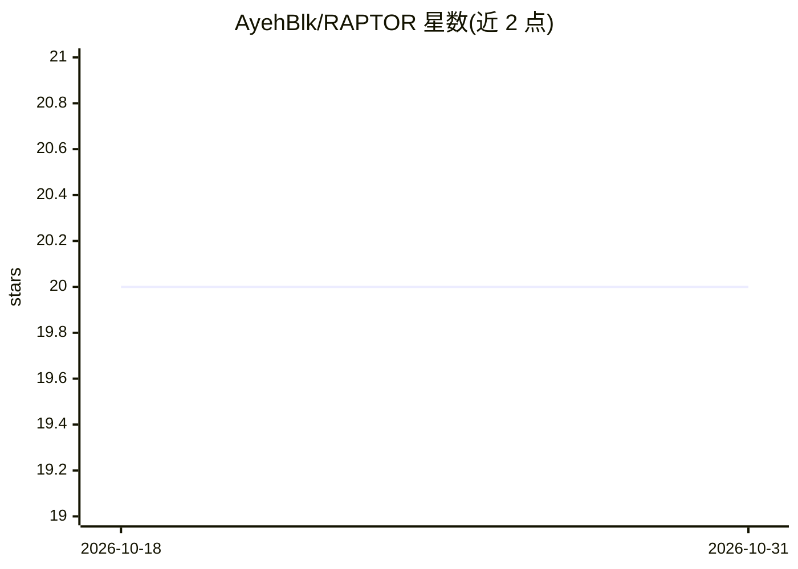

# AyehBlk/RAPTOR

⭐ 20 · Python · MIT · 推送 2026-10-15 · [GitHub](https://github.com/AyehBlk/RAPTOR) · 个人维护

**RNA-seq 全流程分析框架：数据获取到差异表达与生物标志物发现**

开源 Python 框架，覆盖 RNA-seq 分析全流程：从 GEO/SRA/TCGA 检索下载测序数据集、质量评估、32 特征数据剖析，到差异表达（DESeq2/edgeR/limma 的 Python 封装）、集成分析、阈值优化与基因面板生物标志物发现。提供随机森林与规则两种流水线推荐模式，以及嵌套交叉验证的标志物发现管线（8 种特征选择、4 种分类器）。面向研究人员，通过 Streamlit 可视化面板或命令行运行，无需编码。

## 筛选速览

| 维度 | 判定 | 备注 |
|---|---|---|
| AI 角色 | `ai-native` | 本体是模型或模型工具 |
| 许可风险 | `permissive` | MIT |
| 部署形态 | `library` | 以包/库形式分发 |
| 模型依赖 | — | README 未给出锁定关系 |
| 硬件要求 | — | 无带数字的原话,不猜 |
| 安装摩擦 | `low` | 无编译、无系统依赖或容器化 |
| 成熟度 | `idea` | |

## 能力要点

- 32 特征数据剖析与双模式流水线推荐（Random Forest / 规则）
- DESeq2、edgeR、limma 三工具结果集成（5 种合并方法）
- 嵌套交叉验证的生物标志物发现（8 种特征选择 + 4 种分类器，含防泄漏处理）
- GEO/SRA/TCGA 数据集检索下载与多队列合并（基因 ID 调和 + 批次校正）

## 适用场景

- 不想手动挑选流水线的研究者获取数据驱动的推荐
- 跨多数据集做差异表达并取共识结果
- 做跨队列基因面板生物标志物发现与验证
- 从面板界面直接检索下载公共 RNA-seq 数据

## 场景标签

`科研工具` · 领域:学习与行业

## 证据(README 行号)

> L26: **RAPTOR** is an open-source Python framework that covers the full RNA-seq analysis workflow — from finding and dow
> L34: - Profile your data across 32 features (BCV, dispersion, sparsity, sample balance, and more) and get pipeline recom
> L72: A Random Forest classifier trained on dataset features tells you which quantification pipeline to use and how confi

## 星数曲线

2026-10-18 20 → 2026-10-31 20（+0）

---
*卡片 v1 · prompt 1.4 · 生成 2026-10-28 · 置信度 high · 依据 README sha `7319a5768e0d` · [字段定义](../../DATASET.md)*
