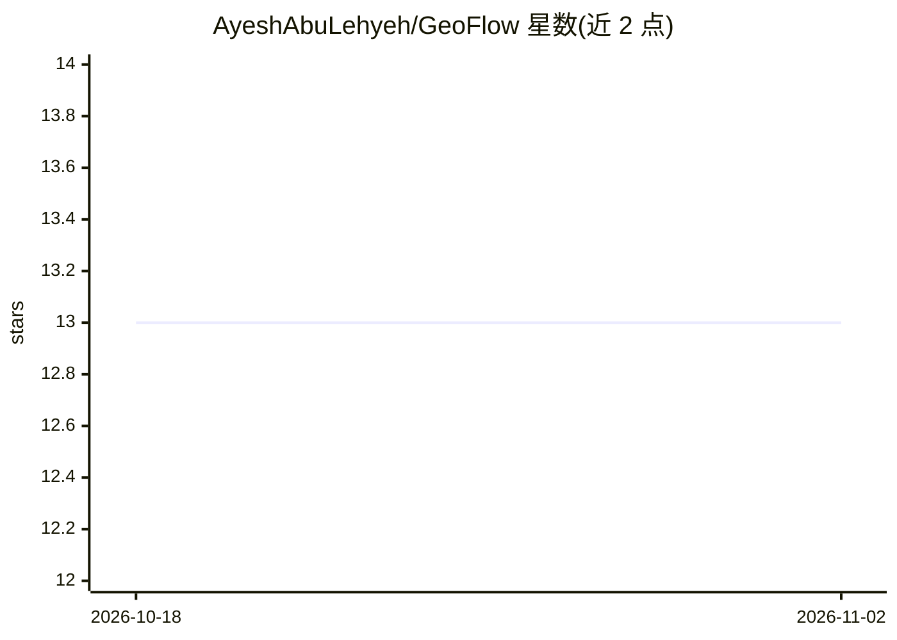

# AyeshAbuLehyeh/GeoFlow

⭐ 13 · Python · 推送 2026-10-13 · [GitHub](https://github.com/AyeshAbuLehyeh/GeoFlow) · 组织维护

**CVPR'26 论文官方实现：细粒度跨视角地理定位框架**

GeoFlow（CVPR 2026）的官方训练与评估代码，将定位建模为迭代流细化问题：模型一次提取共享视觉上下文，通过轻量更新迭代修正坐标估计。仓库提供 KITTI 与 VIGOR 两个数据集的完整实现，支持已知朝向与联合预测朝向两种设定，VIGOR 支持 same-area 与 cross-area 划分，误差以米为单位按城市卫星图地面分辨率报告。安装方式为 git clone 源码 + conda 环境 + pip 依赖，需自行下载并组织数据集。

## 筛选速览

| 维度 | 判定 | 备注 |
|---|---|---|
| AI 角色 | `ai-native` | 本体是模型或模型工具 |
| 许可风险 | `none` | — |
| 部署形态 | `library` | 以包/库形式分发 |
| 模型依赖 | — | README 未给出锁定关系 |
| 硬件要求 | — | 无带数字的原话,不猜 |
| 安装摩擦 | `low` | 无编译、无系统依赖或容器化 |
| 成熟度 | — | 结构信号不足 |

## 能力要点

- 迭代流细化预测坐标估计的定位框架
- 提供 KITTI 与 VIGOR 数据集的训练/评估脚本
- 支持已知朝向与联合预测朝向两种模型
- 评估输出文本与 JSON 摘要，误差按城市分辨率以米报告

## 适用场景

- 复现论文在 KITTI/VIGOR 上的训练与评估结果
- 研究地面图像与卫星图像的跨视角定位方法
- 在自有数据上微调或扩展跨视角定位模型

## 场景标签

 · 领域:计算机视觉/地理定位

## 证据(README 行号)

> L7: GeoFlow is a lightweight framework for fine-grained cross-view geolocalization. The method formulates localization a
> L9: This repository contains the training and evaluation code for both **KITTI** and **VIGOR**.

## 星数曲线

2026-10-18 13 → 2026-11-02 13（+0）

---
*卡片 v1 · prompt 1.4 · 生成 2026-10-31 · 置信度 mid · 依据 README sha `8148689dcd27` · [字段定义](../../DATASET.md)*
