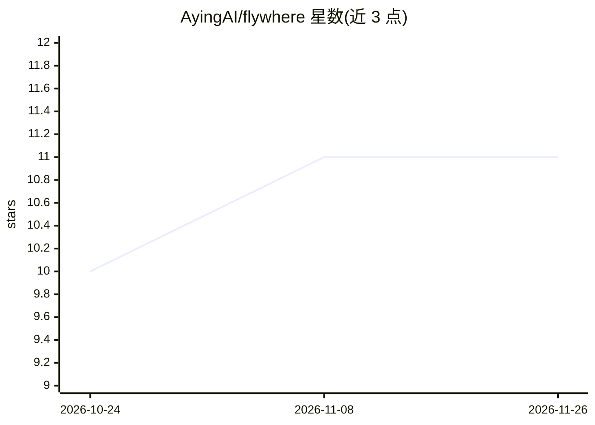

# AyingAI/flywhere

⭐ 11 · HTML · MIT · 推送 2026-11-23 · [GitHub](https://github.com/AyingAI/flywhere) · 个人维护 · 中文 README

**帮旅行者按票价探索国内外低价机票目的地的工具**

本地运行的机票目的地探索工具，提供 macOS/Windows 桌面应用与 Node.js 网页版。选好出发地和日期后可查单程与往返航班，在全国及国际地图上比较票价、航线和行程时间；支持真实往返组合、多机场出发、透明价格口径与本地查询记录。航班数据来自飞猪 AI 开放平台（经 FlyAI CLI），AI 仅提供可选的取舍解释建议，不参与筛选或排序。项目不负责登录、占座或下单。

## 筛选速览

| 维度 | 判定 | 备注 |
|---|---|---|
| AI 角色 | `ai-enhanced` | 去掉 AI 部分产品仍成立 |
| 许可风险 | `permissive` | MIT |
| 部署形态 | `desktop` | 安装包/桌面程序 |
| 模型依赖 | — | README 未给出锁定关系 |
| 硬件要求 | — | 无带数字的原话,不猜 |
| 安装摩擦 | `low` | 无编译、无系统依赖或容器化 |
| 成熟度 | — | 结构信号不足 |

## 能力要点

- 真实往返组合：去回程允许不同航司，展示票面价、机建燃油费与全员总价
- 全国与国际目的地探索，地图/列表双视图，支持直飞、预算、时长筛选
- API Key 经 Electron safeStorage 加密保存在本机，查询记录本地保存
- 可选 AI 建议，支持 OpenAI 兼容 API 或本地已登录 CLI

## 适用场景

- 按预算寻找周末或假期的低价出行目的地
- 比较上海虹桥/浦东等多机场出发的航班组合
- 出境前比较亚洲、欧洲等热门城市的往返报价

## 场景标签

 · 领域:旅行/出行工具

## 证据(README 行号)

> L11: 飞哪里是一个本地运行的机票探索工具，提供 macOS 与 Windows 桌面应用，也可以用 Node.js 启动网页版。选好出发地和日期后，可以查单程或往返航班，也可以在国内和国际地图上比较不同目的地的票价、航线和行程时间。
> L93: - **可选 AI 建议**：AI 解释“优先考虑、最省钱、少折腾”的取舍，但不会筛选或改动价格排序；建议会随查询记录保存在本地。
> L127: 航班搜索本身不依赖 AI。需要 AI 建议时，可任选一种方式：

## 星数曲线

2026-10-24 10 → 2026-11-26 11（+1）

---
*卡片 v1 · prompt 1.4 · 生成 2026-11-19 · 置信度 mid · 依据 README sha `78a3269f7891` · [字段定义](../../DATASET.md)*
