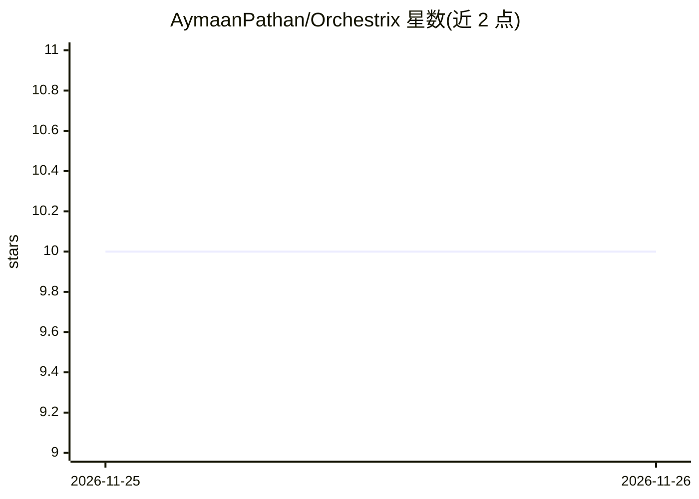

# AymaanPathan/Orchestrix

⭐ 10 · TypeScript · 推送 2026-03-24 · [GitHub](https://github.com/AymaanPathan/Orchestrix) · 个人维护

**让非程序员用自然语言生成可视化后端 API 与自动化工作流**

基于 Next.js 与 React Flow 的可视化后端构建器，运行时依赖 Motia 工作流引擎。用户用英文描述需求，系统经 Groq 调用 LLM 生成节点工作流（输入校验、数据库、邮件、认证等），支持拖拽编辑、实时执行日志，保存后自动生成可调用的 API 端点，另支持 cron 定时任务。需自行部署前后端并配置 MongoDB 与 Groq API key。

## 筛选速览

| 维度 | 判定 | 备注 |
|---|---|---|
| AI 角色 | `ai-native` | 本体是模型或模型工具 |
| 许可风险 | `none` | — |
| 部署形态 | `library` | 以包/库形式分发 |
| 模型依赖 | locked-api |  |
| 硬件要求 | — | 无带数字的原话,不猜 |
| 安装摩擦 | `low` | 无编译、无系统依赖或容器化 |
| 成熟度 | — | 结构信号不足 |

## 能力要点

- 英文描述自动生成带节点连接与数据流的工作流
- React Flow 可视化节点编辑器与分类节点库
- 保存工作流即时生成 API 端点与 cron 任务
- Socket 实时执行日志：逐节点输入/输出与耗时

## 适用场景

- 不会写代码也能搭建登录注册等后端 API
- 快速生成带邮件通知的 CRUD 接口
- 配置每周定时取数并发报告的自动化任务

## 场景标签

`工作流自动化` `代码生成` · 领域:效率与自动化

## 证据(README 行号)

> L7: Orchestrix is a visual backend builder powered by Motia's scalable workflows, where anyone — even without coding — c
> L150: - **Provider:** Groq (Claude/GPT models)

## 星数曲线

2026-11-25 10 → 2026-11-26 10（+0）

---
*卡片 v1 · prompt 1.4 · 生成 2026-11-24 · 置信度 high · 依据 README sha `6c138a5a8cc0` · [字段定义](../../DATASET.md)*
