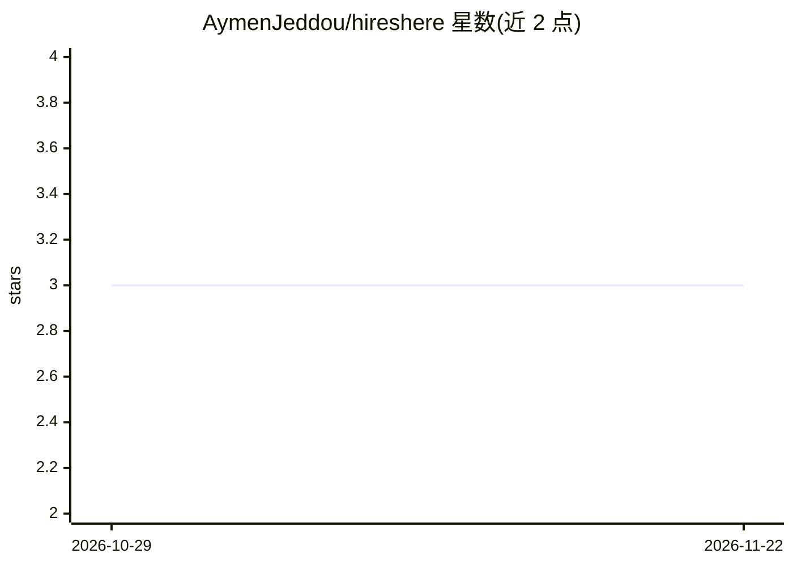

# AymenJeddou/hireshere

⭐ 3 · Python · MIT · 推送 2026-11-14 · [GitHub](https://github.com/AymenJeddou/hireshere) · [官网](https://hireshere.app) · 个人维护

**按 243 国判定远程岗位可申请性的每日聚合管线**

每日抓取约 540 家公司招聘板（Greenhouse、Lever、Ashby 等系统及 Remote OK、Jobicy），对远程/混合岗位用 LLM 按 Pydantic 模式抽取远程类型、允许国家/地区、时区窗口、工作许可等信息并附原文证据句，再由纯 Python 规则在导出时为 243 个国家生成判定，无需为每个国家调用 AI。发布为 Cloudflare Pages 上的 Astro 静态站，附邮件与 Telegram 提醒；抓取仅使用公司公开 feed，不抓取禁止的站点。

## 筛选速览

| 维度 | 判定 | 备注 |
|---|---|---|
| AI 角色 | `ai-enhanced` | 去掉 AI 部分产品仍成立 |
| 许可风险 | `permissive` | MIT |
| 部署形态 | `None` |  |
| 模型依赖 | — | README 未给出锁定关系 |
| 硬件要求 | — | 无带数字的原话,不猜 |
| 安装摩擦 | `low` | 无编译、无系统依赖或容器化 |
| 成熟度 | — | 结构信号不足 |

## 能力要点

- 为每个岗位-国家组合输出判定及岗位原文证据句
- LLM 抽取后由 Python 规则按 243 国批量出判定，新增国家零 AI 调用
- Gemini 免费额度用尽后自动切换 Groq/Mistral 同队列，支持计费批处理模式
- 抓取、判定与建站管线以 GitHub Actions 每日运行

## 适用场景

- 在美国和欧洲之外找可申请的远程工作
- 为特定国家筛选远程岗位并核验位置限制依据
- 自建基于公开招聘 feed 的岗位数据管线

## 场景标签

`网页抓取` `工作流自动化` · 领域:效率与自动化

## 证据(README 行号)

> L11: Most "remote" jobs are remote only inside one country or region. The location rule is buried in the posting ("must 
> L25: 3. **Decide.** Plain Python rules (`pipeline/classify/verdict.py`) turn one extraction into a verdict for each of 2

## 星数曲线

2026-10-29 3 → 2026-11-22 3（+0）

---
*卡片 v1 · prompt 1.4 · 生成 2026-11-22 · 置信度 mid · 依据 README sha `80a61cae353f` · [字段定义](../../DATASET.md)*
