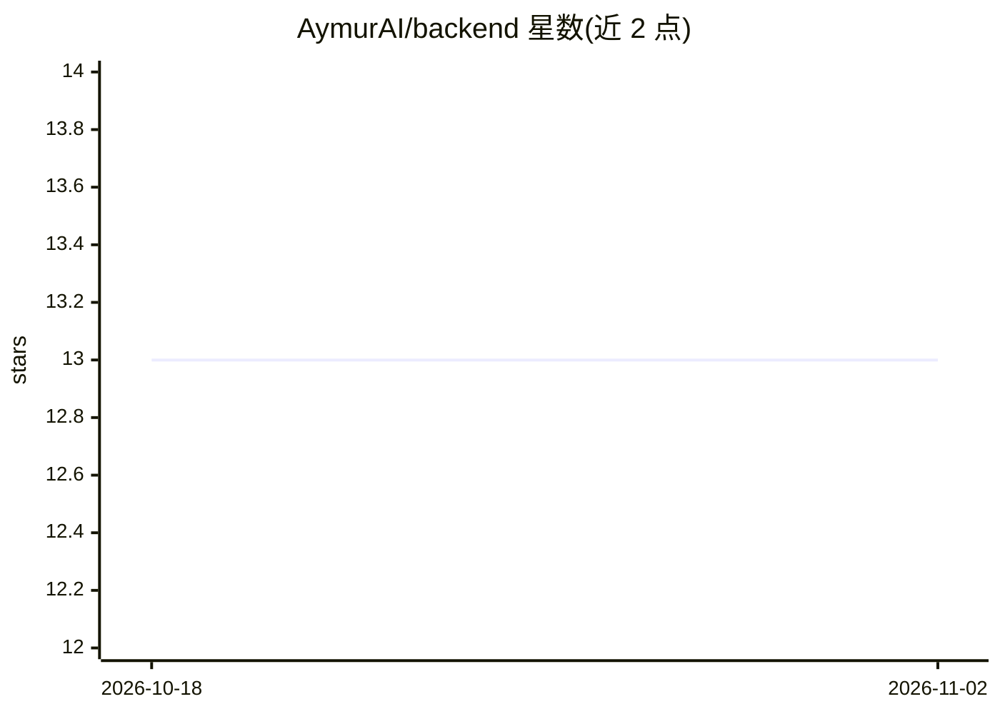

# AymurAI/backend

⭐ 13 · Jupyter Notebook · MIT · 推送 2026-09-12 · [GitHub](https://github.com/AymurAI/backend) · [官网](https://www.aymurai.info) · 组织维护

**面向拉丁美洲性别暴力案件的司法文书匿名化与结构化数据处理平台后端**

提供应用、API 与 ML 管线，处理司法判决文书的两条工作流：anonymizer 抽取命名实体并生成匿名化文档，data-public 抽取结构化信息用于公共数据集建设。本仓库包含 FastAPI 服务、React/Electron 前端、生产管线配置（flair-anonymizer、datapublic）与 SQLModel 数据库持久化。流程覆盖文档上传、ML 推理、人工审核、验证与导出，面向运营与科研用途。以 Docker 镜像提供，支持 CPU 与可选 GPU（NVIDIA Container Toolkit）运行及离线环境部署。

## 筛选速览

| 维度 | 判定 | 备注 |
|---|---|---|
| AI 角色 | `ai-native` | 本体是模型或模型工具 |
| 许可风险 | `permissive` | MIT |
| 部署形态 | `self-host` | docker 或自建部署 |
| 模型依赖 | — | README 未给出锁定关系 |
| 硬件要求 | — | 无带数字的原话,不猜 |
| 安装摩擦 | `low` | 无编译、无系统依赖或容器化 |
| 成熟度 | — | 结构信号不足 |

## 能力要点

- anonymizer 管线：命名实体抽取与匿名化文档生成
- data-public 管线：结构化信息抽取用于公共数据集构建
- FastAPI 服务含 Swagger UI、健康检查与验证端点
- Docker 镜像支持 CPU/GPU 与封闭网络离线部署

## 适用场景

- 司法机构对性别暴力案件文书做匿名化处理
- 研究团队从判决文书构建结构化公共数据集
- 在封闭网络环境中部署文书处理服务

## 场景标签

`科研工具` `文档解析` · 领域:知识与检索

## 证据(README 行号)

> L4: AymurAI provides an integrated application, API, and ML pipelines for processing judicial rulings through two main w
> L6: - `anonymizer`: extract named entities and produce anonymized documents.
> L95: - `POST /api/anonymizer/predict`

## 星数曲线

2026-10-18 13 → 2026-11-02 13（+0）

---
*卡片 v1 · prompt 1.4 · 生成 2026-10-31 · 置信度 high · 依据 README sha `a66db1c963d6` · [字段定义](../../DATASET.md)*
