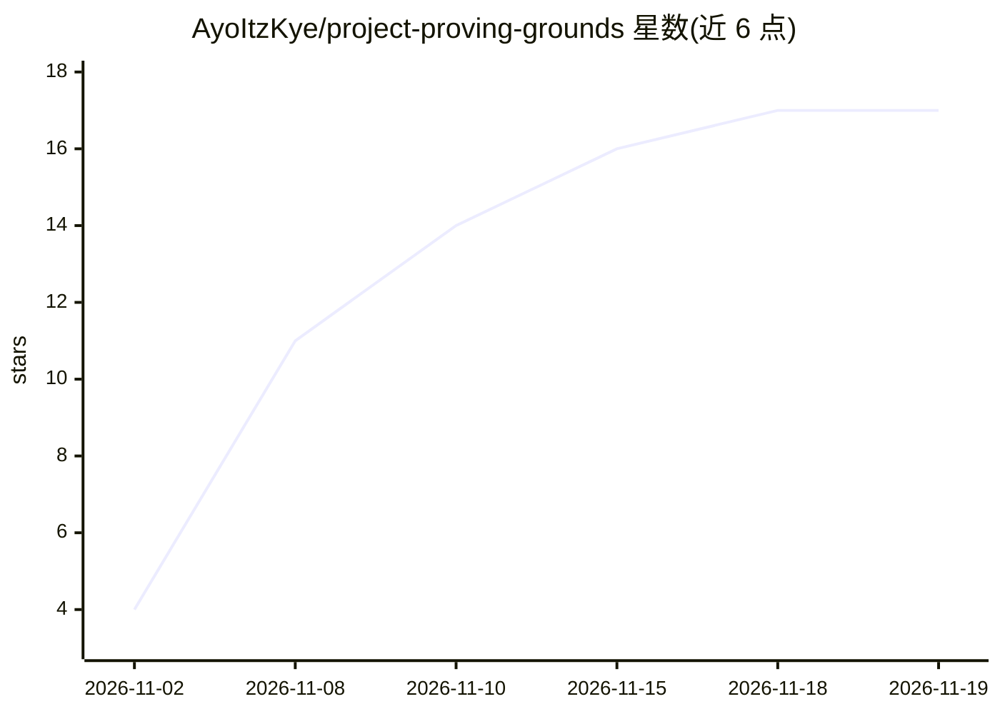

# AyoItzKye/project-proving-grounds

⭐ 17 · Python · NOASSERTION · 推送 2026-11-18 · [GitHub](https://github.com/AyoItzKye/project-proving-grounds) · 个人维护

**给 Halo MCC 玩家的离线自定义对局 PvP 机器人模组**

面向 PC 版《光环：士官长合集》玩家的 Windows 安装型模组：在离线自定义对局（需关闭 Easy Anti-Cheat）中加入最多 15 个以真实玩家身份出现在记分板上的机器人，覆盖移动、瞄准、走位、跳射、拾取强力武器、驾驶与飞行载具、占点与队伍内语音报点。提供 4 档难度外加跟随玩家战绩的 Scaling 难度、7 种打法风格，支持 CE/2/3/Reach/4 自定义对局与 Firefight。地图需通过 LiDAR 模拟器或对局内被动扫描自行建图，不随模组分发；限制为仅离线自定义对局，不触碰联机匹配与线上服务。

## 筛选速览

| 维度 | 判定 | 备注 |
|---|---|---|
| AI 角色 | `ai-enhanced` | 去掉 AI 部分产品仍成立 |
| 许可风险 | `none` | NOASSERTION |
| 部署形态 | `desktop` | 安装包/桌面程序 |
| 模型依赖 | — | README 未给出锁定关系 |
| 硬件要求 | — | 无带数字的原话,不猜 |
| 安装摩擦 | `low` | 无编译、无系统依赖或容器化 |
| 成熟度 | — | 结构信号不足 |

## 能力要点

- 最多 15 个机器人，以真实玩家身份出现在 16 人对局记分板
- LiDAR 地图扫描：模拟器主动建图 + 对局内被动学习，配套 3D 查看器
- 每队独立 director：地图报点、按模式分配角色、按比分与时间调整策略
- Observer 回放工具：查看每个机器人所见/所想/所做，并对比玩家自身数据

## 适用场景

- 没有联机条件时在离线自定义对局里和机器人打 PvP
- 通过 Scaling 难度让机器人水平自动贴近自己，保持对局均势
- 回放并分析机器人决策与自己操作数据以提升水平

## 场景标签

 · 领域:游戏/游戏模组

## 证据(README 行号)

> L5: PvP bots for **Halo: The Master Chief Collection** on PC. Bots join your offline custom games as real players on the
> L13: > Offline custom games only, with Easy Anti-Cheat off. The mod refuses to run with anti-cheat on and never touches

## 星数曲线

2026-11-02 4 → 2026-11-19 17（+13）

---
*卡片 v1 · prompt 1.4 · 生成 2026-11-18 · 置信度 high · 依据 README sha `11eb9791776a` · [字段定义](../../DATASET.md)*
