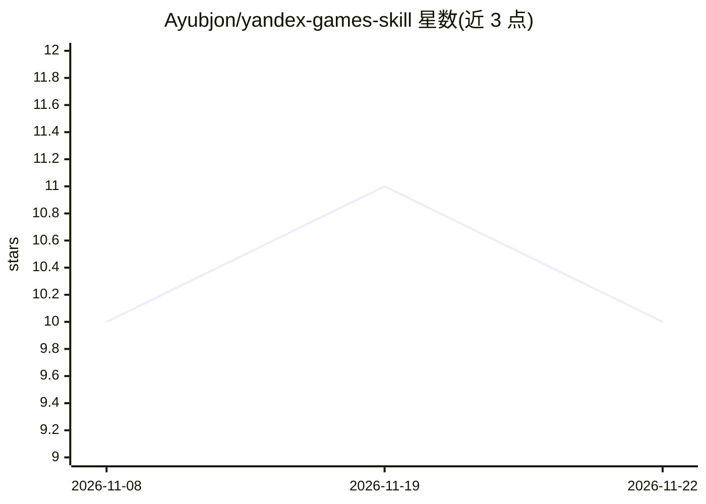

# Ayubjon/yandex-games-skill

⭐ 10 · Python · MIT · 推送 2026-09-26 · [GitHub](https://github.com/Ayubjon/yandex-games-skill) · 个人维护

**给 AI agent 用的 Yandex Games 游戏开发与发布技能包**

面向 AI agent 的 SKILL.md 技能包，内容为 Yandex Games 平台的 SDK 集成流程、发布前诊断与审核准备：包含 93 项检查的调试 checker（来自上游 Nioris/yandex-games-debug-checker v1.1.0，MIT）、SDK 封装、JavaScript/Three.js/Unity/Godot Web 构建的引擎指南、发布 ZIP 审查脚本及手动检查清单。通过将整个目录复制到 agent 技能目录使用，支持 Codex 与 Claude Code 路径；checker 为非官方工具，PASS 不保证通过审核。

## 筛选速览

| 维度 | 判定 | 备注 |
|---|---|---|
| AI 角色 | `ai-knowledge` | 知识聚合/清单类 |
| 许可风险 | `permissive` | MIT |
| 部署形态 | `None` |  |
| 模型依赖 | — | README 未给出锁定关系 |
| 硬件要求 | — | 无带数字的原话,不猜 |
| 安装摩擦 | `low` | 无编译、无系统依赖或容器化 |
| 成熟度 | — | 结构信号不足 |

## 能力要点

- 93 项自动化检查目录，含修复说明跳转
- SDK 封装：统一初始化、错误重试、ready 与奖励防重复
- 发布 ZIP 检查脚本输出 JSON 与 CI 退出码
- 保留上游 commit 与 SHA-256 的溯源与锁定

## 适用场景

- 让 agent 给现有 Three.js 游戏接入 Yandex Games SDK
- 发布前跑 checker 生成带证据的审核报告
- 排查审核拒绝原因（如 Game Ready 触发过早）

## 场景标签

 · 领域:游戏开发/agent技能

## 证据(README 行号)

> L3: Практический скилл для интеграции SDK, диагностики и подготовки игр к публикации в Яндекс Играх. Основной источник —
> L9: - SKILL.md: последовательность интеграции, аудита, исправления и проверки релиза.
> L22: Скопируйте **всю папку**, включая `references`, `assets`, `scripts` и `vendor`, в каталог скиллов вашего агента под

## 星数曲线

2026-11-08 10 → 2026-11-22 10（+0）

---
*卡片 v1 · prompt 1.4 · 生成 2026-11-19 · 置信度 high · 依据 README sha `e001ed0a59ed` · [字段定义](../../DATASET.md)*
