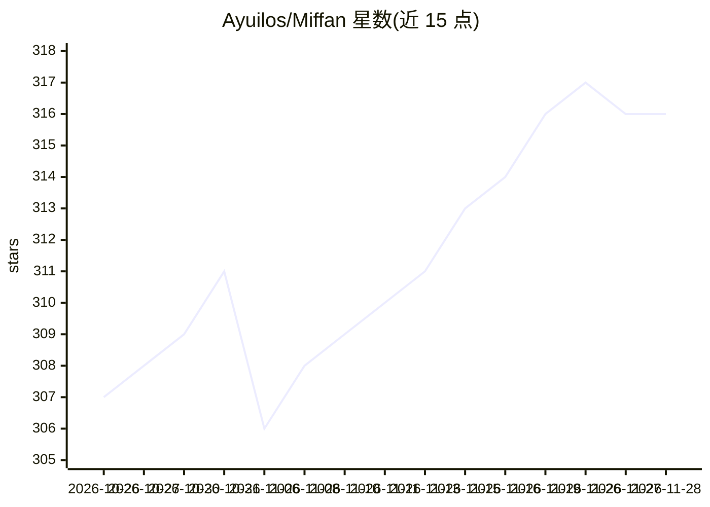

# Ayuilos/Miffan

⭐ 316 · Kotlin · AGPL-3.0 · 推送 2026-11-26 · [GitHub](https://github.com/Ayuilos/Miffan) · [官网](https://miffan.ayuilos.me) · 个人维护 · 中文 README

**Android AI 聊天客户端，支持多伙伴协作与远程电脑控制**

Fork 自 RikkaHub 的 Android AI 客户端（Kotlin/Jetpack Compose 编写，AGPL-3.0），以类即时消息界面与 AI 伙伴对话：一人一长期会话、并行提问、群聊与 @ 提及、记忆管理、绘图与翻译。不带模型，用户接入 OpenAI 兼容 API、Gemini、Claude、ChatGPT 订阅（Codex 登录）、OpenRouter 或自建 Magpie 网关。伙伴经 SSH/Tailscale/中继连接 Mac/Windows/Linux 电脑执行操作，含 Sunshine 高性能低延迟串流模式与定时任务。关键机制：操作需卡片式审批、权限历史可撤销；数据可 WebDAV/S3 备份，可导入 RikkaHub、Chatbox、Cherry Studio 数据。发布 arm64-v8a APK，源码构建需 JDK 17、NDK、Node.js 等。

## 筛选速览

| 维度 | 判定 | 备注 |
|---|---|---|
| AI 角色 | `ai-native` | 本体是模型或模型工具 |
| 许可风险 | `viral` | AGPL-3.0 |
| 部署形态 | `library` | 以包/库形式分发 |
| 模型依赖 | locked-api |  |
| 硬件要求 | — | 无带数字的原话,不猜 |
| 安装摩擦 | `high` | 编译与系统依赖俱全 |
| 成熟度 | — | 结构信号不足 |

## 能力要点

- 类消息界面：一人一会话、并行提问、群聊与 @ 提及协作
- 伙伴经 SSH/中继操控 Mac/Windows/Linux 电脑，Sunshine 串流降低延迟
- 操作审批卡片、权限历史与可撤销的变更记录
- 接入 OpenAI 兼容/Gemini/Claude/ChatGPT 订阅/OpenRouter/Magpie，本地存储

## 适用场景

- 在手机上以聊天方式使用自有的各家 AI API 与订阅
- 让 AI 伙伴远程操作自己的电脑或无屏服务器执行任务
- 多伙伴群聊分工处理问题并管理各自记忆
- 从 RikkaHub、Chatbox、Cherry Studio 迁移聊天数据

## 场景标签

`聊天机器人` `AI 助手` · 领域:对话与助手

## 证据(README 行号)

> L3:  An Android AI app you talk to like a friend, with partners that team up and can work on your computer.
> L15: Bring the AI service you already use, whether that's an API key for an OpenAI-compatible, Gemini or Claude service,

## 星数曲线

2026-10-26 307 → 2026-11-28 316（+9）

---
*卡片 v1 · prompt 1.4 · 生成 2026-11-25 · 置信度 high · 依据 README sha `e075f2fd84e7` · [字段定义](../../DATASET.md)*
