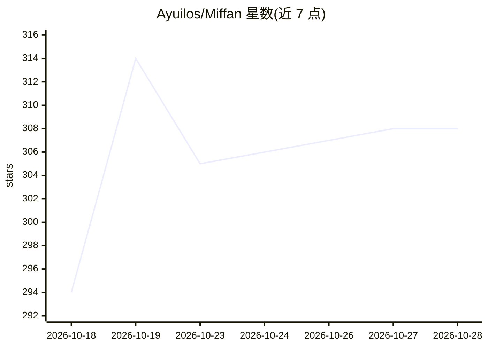

# Ayuilos/Miffan

⭐ 308 · Kotlin · AGPL-3.0 · 推送 2026-10-26 · [GitHub](https://github.com/Ayuilos/Miffan) · [官网](https://miffan.ayuilos.me) · 个人维护 · 中文 README

**Android AI 对话客户端：伙伴式聊天与远程控制你的电脑**

RikkaHub 的独立 fork，面向终端用户的 Android AI 聊天应用：每个 AI 伙伴对应一段持续对话，支持多伙伴群聊协作、多问题并行、记忆管理与绘画。用户自带 AI 服务（OpenAI 兼容 API、Gemini、Claude、ChatGPT 订阅登录、OpenRouter 或自建 Magpie 网关），应用本身不捆绑模型，数据留在手机。还可通过 SSH 连接 Mac/Windows/Linux 电脑，让伙伴在桌面或无屏服务器上执行操作，配合 Sunshine 实现低延迟远程画面；支持定时任务、MCP 工具与逐项审批。专业模式提供提示词、模型参数、本地 Linux 工作区等配置。

## 筛选速览

| 维度 | 判定 | 备注 |
|---|---|---|
| AI 角色 | `ai-native` | 本体是模型或模型工具 |
| 许可风险 | `viral` | AGPL-3.0 |
| 部署形态 | `library` | 以包/库形式分发 |
| 模型依赖 | — | README 未给出锁定关系 |
| 硬件要求 | — | 无带数字的原话,不猜 |
| 安装摩擦 | `high` | 编译与系统依赖俱全 |
| 成熟度 | — | 结构信号不足 |

## 能力要点

- 伙伴式对话：一伙伴一对话流，自动分题，多问题并行回答
- 通过 SSH/Tailscale 远程使用与控制 Mac/Windows/Linux 电脑，Sunshine 高性能模式
- 用户自带 AI 服务（API key/Codex 订阅/OpenRouter/Magpie），不捆绑模型，数据留本地
- 定时任务、MCP 工具调用、逐项审批卡与权限历史

## 适用场景

- 在手机上像聊天软件一样与多个 AI 伙伴对话协作
- 让 AI 伙伴在自家电脑上执行操作并从手机远程查看
- 跨应用划词翻译、语音输入输出与本地 Linux 工作区

## 场景标签

`聊天机器人` `AI 助手` · 领域:对话与助手

## 证据(README 行号)

> L3:  An Android AI app you talk to like a friend, with partners that team up and can work on your computer.
> L15: Bring the AI service you already use, whether that's an API key for an OpenAI-compatible, Gemini or Claude service,
> L95: Miffan started as a fork of RikkaHub, an open-source Android LLM client, and has since grown into an independent ap

## 星数曲线

2026-10-18 294 → 2026-10-28 308（+14）

---
*卡片 v1 · prompt 1.4 · 生成 2026-10-22 · 置信度 mid · 依据 README sha `2587d862ffcf` · [字段定义](../../DATASET.md)*
