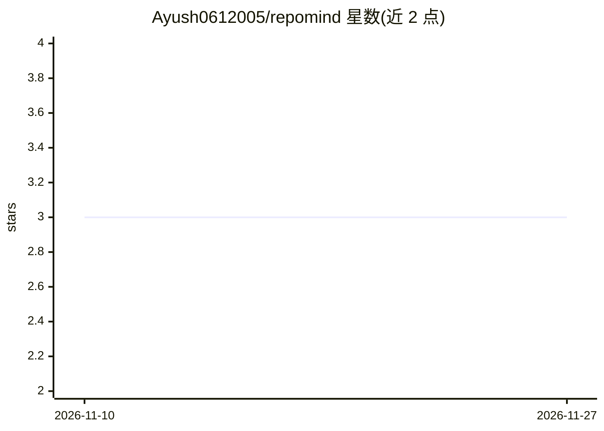

# Ayush0612005/repomind

⭐ 3 · Java · 推送 2026-11-08 · [GitHub](https://github.com/Ayush0612005/repomind) · 个人维护

**面向开发者的 Java 代码库问答与 PR 审查智能服务**

RepoMind 接入一个 GitHub Java 仓库后，以带 file:line 引用的形式回答代码问题、对 pull request 发布审查评论，并以 MCP 服务器形式暴露 search_code、explain_class、ask_codebase 等工具供编码 agent 调用。工程机制包括 Kafka 异步摄取、JavaParser AST 分块、向量+全文混合检索、Redis 精确与 pgvector 语义两级答案缓存、API key 限流与每日 token 预算、Claude→Ollama 供应商熔断回退，以及 40 题检索评测门禁 CI。技术栈为 Java 25 / Spring Boot 4.1 / Spring AI / PostgreSQL+pgvector。

## 筛选速览

| 维度 | 判定 | 备注 |
|---|---|---|
| AI 角色 | `ai-native` | 本体是模型或模型工具 |
| 许可风险 | `none` | — |
| 部署形态 | `self-host` | docker 或自建部署 |
| 模型依赖 | local-ok | 支持本地模型 |
| 硬件要求 | — | 无带数字的原话,不猜 |
| 安装摩擦 | `low` | 无编译、无系统依赖或容器化 |
| 成熟度 | — | 结构信号不足 |

## 能力要点

- 带 file:line 引用的代码库问答与 PR 自动审查（GitHub webhook 触发）
- MCP 服务器（Streamable HTTP）供编码 agent 直接查询已索引仓库
- 混合检索（向量+全文）+ 两级答案缓存 + 每客户端 token 预算
- 40 题检索评测在 CI 门禁，附 recall@k/MRR 与端到端答案评测报告

## 适用场景

- 让团队用自然语言检索和理解陌生 Java 仓库的代码
- 在 PR 打开时自动生成审查评论
- 让 Claude Code 等编码 agent 通过 MCP 直接查询已索引代码库

## 场景标签

`RAG` `代码审查` `模型评测` · 领域:编码与开发

## 证据(README 行号)

> L3: RepoMind ingests a GitHub Java repository and answers questions about it with file/line citations,
> L4: reviews pull requests, and exposes itself as an **MCP server** so AI agents can query codebases.
> L36: |Agent access|MCP server (Streamable HTTP) exposing `search_code`, `explain_class`, `ask_codebase`|

## 星数曲线

2026-11-10 3 → 2026-11-27 3（+0）

---
*卡片 v1 · prompt 1.4 · 生成 2026-11-22 · 置信度 high · 依据 README sha `5ed29f332170` · [字段定义](../../DATASET.md)*
