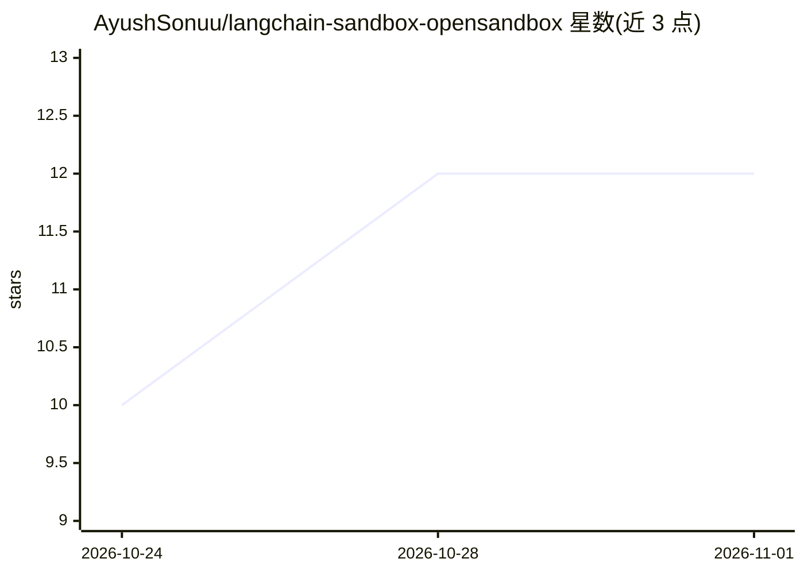

# AyushSonuu/langchain-sandbox-opensandbox

⭐ 12 · Python · Apache-2.0 · 推送 2026-08-17 · [GitHub](https://github.com/AyushSonuu/langchain-sandbox-opensandbox) · [官网](https://pypi.org/project/langchain-sandbox-opensandbox/) · 个人维护

**让 LangChain Deep Agents 在 OpenSandbox 沙箱中执行代码与文件操作**

将 OpenSandbox Python SDK 适配到 Deep Agents 的 BaseSandbox 接口的适配器库：实现 execute、upload_files、download_files 三个沙箱原语，使 agent 的 shell 与文件工具（ls、read_file、write_file、glob、grep）在隔离的 OpenSandbox 环境中运行而非宿主机。通过 ConnectionConfigSync 指向指定服务器，可用 Docker 在本地启动 OpenSandbox 服务。集成测试运行 langchain-tests 的标准 SandboxIntegrationTests 一致性套件（86/86 通过），以 uv add 安装。

## 筛选速览

| 维度 | 判定 | 备注 |
|---|---|---|
| AI 角色 | `ai-ecosystem` | LLM/agent 周边工具 |
| 许可风险 | `permissive` | Apache-2.0 |
| 部署形态 | `library` | 以包/库形式分发 |
| 模型依赖 | — | README 未给出锁定关系 |
| 硬件要求 | — | 无带数字的原话,不猜 |
| 安装摩擦 | `low` | 无编译、无系统依赖或容器化 |
| 成熟度 | — | 结构信号不足 |

## 能力要点

- 实现 execute/upload_files/download_files 三个沙箱原语
- agent 文件与 shell 工具在隔离 OpenSandbox 环境中运行
- 继承 BaseSandbox 的 ls/read_file/write_file/glob/grep 帮助函数
- 通过 langchain-tests 标准一致性套件（86/86，真实 I/O）

## 适用场景

- 让 Deep Agents 生成的代码在沙箱中执行而非宿主机
- 为 LangChain agent 接入自托管 OpenSandbox 服务器
- 需要隔离文件操作与命令执行的 agent 工作流

## 场景标签

`Agent 框架` · 领域:Agent 开发

## 证据(README 行号)

> L27: Pass the backend to a Deep Agent so the agent's file and shell tools run
> L44: `OpenSandboxBackend` adapts the OpenSandbox

## 星数曲线

2026-10-24 10 → 2026-11-01 12（+2）

---
*卡片 v1 · prompt 1.4 · 生成 2026-11-01 · 置信度 high · 依据 README sha `66102aa92fad` · [字段定义](../../DATASET.md)*
