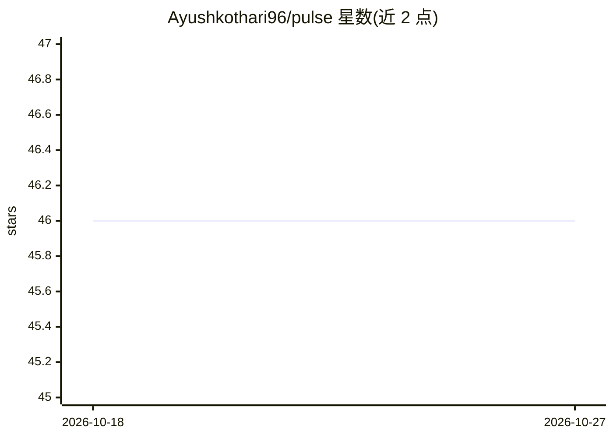

# Ayushkothari96/pulse

⭐ 46 · C · MIT · 推送 2026-03-18 · [GitHub](https://github.com/Ayushkothari96/pulse) · 个人维护

**STM32 微控制器上的实时振动异常检测设备（~$15 硬件）**

基于 Zephyr RTOS 与 ST NanoEdge AI 的嵌入式预测性维护设备：在 STM32L412 + LIS2DH12 定制 PCB（约 15 美元）上完成设备端学习与推理，无需云端或网络。约 30 秒学习机器正常振动基线，之后以 <600ms 周期输出相似度分数，三级阈值（≥90% 正常、70–89% 警告、<70% 异常），板载蜂鸣器与 LED 告警；训练样本经 CRC32 校验持久化于内部 flash。提供 Python GUI 监视器与 USB 命令行。作者为个人嵌入式工程师的周末项目，重型工业机械尚未实测，Linux/macOS 构建路径未完全验证。

## 筛选速览

| 维度 | 判定 | 备注 |
|---|---|---|
| AI 角色 | `ai-native` | 本体是模型或模型工具 |
| 许可风险 | `permissive` | MIT |
| 部署形态 | `library` | 以包/库形式分发 |
| 模型依赖 | — | README 未给出锁定关系 |
| 硬件要求 | — | 无带数字的原话,不猜 |
| 安装摩擦 | `medium` | 含编译或系统依赖之一 |
| 成熟度 | `idea` | |

## 能力要点

- 设备端学习与推理，全程无云端、无网络依赖
- 训练样本持久化于 flash，断电重启后自动恢复模型
- 端到端推理周期 <600ms，500Hz 三轴采样
- 定制 PCB（STM32L412+LIS2DH12）BOM 低于 15 美元

## 适用场景

- 给风扇、泵、电机等振动设备挂载低成本监测
- 小型工厂或车间在无网络环境下做预测性维护
- 通过 USB GUI 实时查看振动相似度分数与告警

## 场景标签

 · 领域:工业物联网/嵌入式 TinyML

## 证据(README 行号)

> L25: 2. **Monitors** continuously in real-time using on-device machine learning
> L60: Pulse uses **STMicroelectronics NanoEdge AI** — a library that runs a trained anomaly detection model entirely on t
> L99: - **Real-time Inference**: Full inference cycle under 600ms end-to-end

## 星数曲线

2026-10-18 46 → 2026-10-27 46（+0）

---
*卡片 v1 · prompt 1.4 · 生成 2026-10-25 · 置信度 mid · 依据 README sha `e1a55c1e0ade` · [字段定义](../../DATASET.md)*
