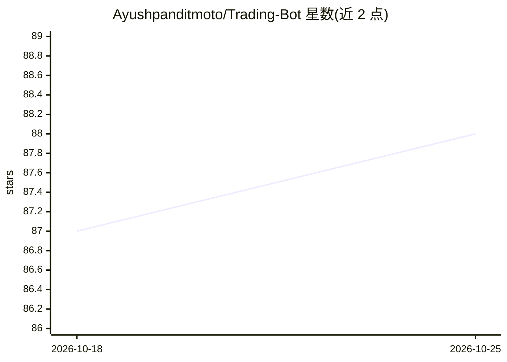

# Ayushpanditmoto/Trading-Bot

⭐ 88 · TypeScript · 推送 2026-08-27 · [GitHub](https://github.com/Ayushpanditmoto/Trading-Bot) · [官网](https://tradingbot69.vercel.app/) · 个人维护

**二元期权交易 AI 机器人的项目构想，预测下一根 K 线方向**

定位为项目构想（project idea）的开源仓库，目标是用机器学习算法分析历史交易数据预测下一根 K 线的涨跌方向，并计划通过 NLP 模块分析交易结果与用户反馈实现持续学习。README 列出八项功能设想，包括实时行情接入、风险管理、绩效监控与用户界面。当前 README 仅含构想描述与贡献指南，通过 git clone 与 pip install -r requirements.txt 获取开发环境，未见具体模型或已实现功能的说明。

## 筛选速览

| 维度 | 判定 | 备注 |
|---|---|---|
| AI 角色 | `ai-native` | 本体是模型或模型工具 |
| 许可风险 | `none` | — |
| 部署形态 | `library` | 以包/库形式分发 |
| 模型依赖 | — | README 未给出锁定关系 |
| 硬件要求 | — | 无带数字的原话,不猜 |
| 安装摩擦 | `low` | 无编译、无系统依赖或容器化 |
| 成熟度 | — | 结构信号不足 |

## 能力要点

- 机器学习预测下一根 K 线涨跌方向的构想
- 计划用 NLP 分析交易结果与用户反馈
- 参与 GSSOC 2024 开源活动，接受社区贡献

## 适用场景

- 作为二元期权交易机器人的功能构想参考
- 参与开源活动学习交易机器人项目结构

## 场景标签

`金融量化` · 领域:学习与行业

## 证据(README 行号)

> L12: Binary Trading AI Bot is a project idea aimed at developing an AI-powered bot for binary trading. The bot utilizes 
> L24: 1. **Predictive Modeling:** Utilize machine learning algorithms to analyze historical trading data and forecast the

## 星数曲线

2026-10-18 87 → 2026-10-25 88（+1）

---
*卡片 v1 · prompt 1.4 · 生成 2026-10-23 · 置信度 low · 依据 README sha `b664e0be67e6` · [字段定义](../../DATASET.md)*
