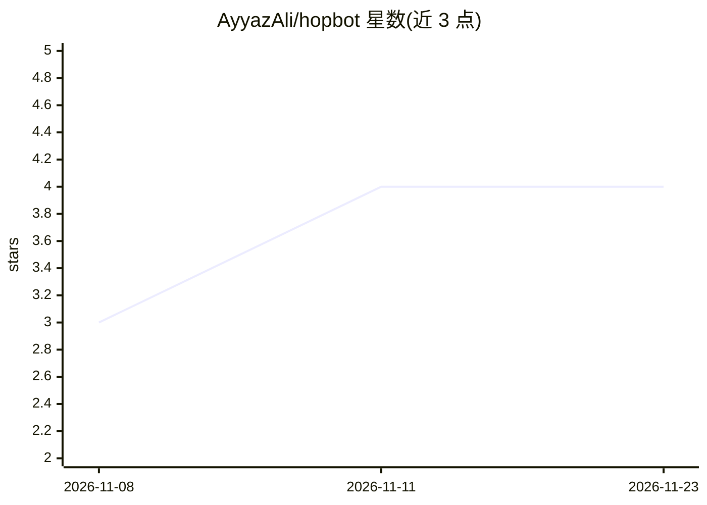

# AyyazAli/hopbot

⭐ 4 · JavaScript · Apache-2.0 · 推送 2026-11-04 · [GitHub](https://github.com/AyyazAli/hopbot) · [官网](https://hopbot.ai) · 个人维护

**给个人用户和开发者的常驻多 Agent 桌面应用**

一款运行 AI Agent 团队的桌面应用（Electron，macOS/Windows），每个 Agent 拥有独立名称、指令、记忆、技能、文件夹和长期会话，可执行命令、写文件、浏览网页、按计划任务与 webhook 工作、互相交接任务。支持通过 SSH 将 Agent 部署到自有 Linux 服务器持续运行，每个 Agent 可获得独立桌面与浏览器。接入 Anthropic/OpenAI/OpenRouter API key 或本地模型，通过 MCP 连接 54 个应用。本地执行风险操作前默认需确认；限制包括 Windows 暂不支持 computer use 与听写，computer use 与内置搜索需 Claude 模型。

## 筛选速览

| 维度 | 判定 | 备注 |
|---|---|---|
| AI 角色 | `ai-native` | 本体是模型或模型工具 |
| 许可风险 | `permissive` | Apache-2.0 |
| 部署形态 | `library` | 以包/库形式分发 |
| 模型依赖 | local-ok | 支持本地模型 |
| 硬件要求 | — | 无带数字的原话,不猜 |
| 安装摩擦 | `low` | 无编译、无系统依赖或容器化 |
| 成熟度 | — | 结构信号不足 |

## 能力要点

- 多 Agent 编排：独立记忆/技能/文件夹，可互相交接后台任务
- 服务器常驻：SSH 一键部署，Agent 独立桌面与浏览器可实时查看
- 模型可替换：Claude/GPT/OpenRouter 或 Ollama、LM Studio、vLLM 本地端点
- MCP 接入 54 个应用，支持例程与 webhook 触发

## 适用场景

- 在 Mac 上让多个 Agent 分工处理研究、文件与日常事务
- 把 Agent 部署到自己的 Linux 服务器上全天候跑定时任务
- 让 Agent 通过 MCP 操作 Gmail、Slack、Notion 等已连接应用
- 用本地模型（Ollama/LM Studio）免 API key 运行 Agent

## 场景标签

`多智能体` `GUI 自动化` `AI 助手` · 领域:Agent 开发

## 证据(README 行号)

> L22: HopBot is a desktop app for running a team of AI agents. Each agent has its own
> L41: - **Any model.** Claude through Anthropic, GPT and o-series models through
> L46: - **Connected apps.** Sign in to 54 apps through MCP, from Gmail and Slack to

## 星数曲线

2026-11-08 3 → 2026-11-23 4（+1）

---
*卡片 v1 · prompt 1.4 · 生成 2026-11-21 · 置信度 high · 依据 README sha `2c797029c88a` · [字段定义](../../DATASET.md)*
