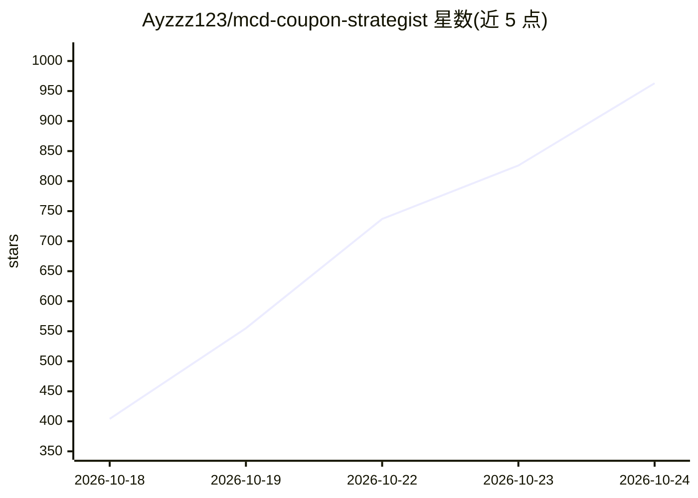

# Ayzzz123/mcd-coupon-strategist

⭐ 1,004 · Python · MIT · 推送 2026-10-21 · [GitHub](https://github.com/Ayzzz123/mcd-coupon-strategist) · [官网](https://github.com/Ayzzz123/mcd-coupon-strategist/blob/main/MCP_INTEGRATION.md) · 个人维护 · 中文 README

**基于麦当劳 MCP 的点餐省钱与券成本审计 Skill**

面向麦当劳中国用户的 MCP Skill，在 WorkBuddy 等 MCP Client 中以对话方式调用。链路 A 枚举单品/套餐/券/凑单组合，经 MCP calculate-price 真实计价输出当前门店最省方案并提示凑单陷阱；链路 B 读取历史订单与券存量，量化即将过期券的沉默成本、按净价值对券包分类（顺手可用/努一把/纸面富贵/无法判断）并做用券排程，另含消费画像、积分体检与可领取券发现。零第三方依赖，demo 用 fixtures 离线回放。需麦当劳 MCP Token 才能真实运行。

## 筛选速览

| 维度 | 判定 | 备注 |
|---|---|---|
| AI 角色 | `ai-ecosystem` | LLM/agent 周边工具 |
| 许可风险 | `permissive` | MIT |
| 部署形态 | `None` |  |
| 模型依赖 | — | README 未给出锁定关系 |
| 硬件要求 | — | 无带数字的原话,不猜 |
| 安装摩擦 | `low` | 无编译、无系统依赖或容器化 |
| 成熟度 | — | 结构信号不足 |

## 能力要点

- 所有金额经 MCP calculate-price 真实计价，不做估算
- 券的沉默成本量化与券包四类净价值判定（明确劝退不划算的券）
- 用券排程：在「券过期前还会点几单」约束下分配券
- 零第三方依赖，demo.py 离线回放录制数据即可跑通两条链路

## 适用场景

- 点餐前算出当前门店预算内最省的组合
- 查清手里哪些券快过期、哪几张不值得用
- 了解自己在麦当劳的月度支出结构与积分状态

## 场景标签

 · 领域:消费/生活工具（MCP 应用）

## 证据(README 行号)

> L17: 基于麦当劳中国 MCP 打造的点餐成本助手，做两件事：
> L315: ### 3. 在 WorkBuddy 中启用
> L411: - 🧩 **你在写 Agent / Skill 的评测** —— 这个项目是一个完整的、双链路的 MCP 编排示例，`saver.py` + `auditor.py` + `mcd_adapter.py` 分层清晰，可直接作为参

## 星数曲线

2026-10-18 404 → 2026-10-24 963（+559）

---
*卡片 v1 · prompt 1.4 · 生成 2026-10-21 · 置信度 high · 依据 README sha `8b0540d84e68` · [字段定义](../../DATASET.md)*
