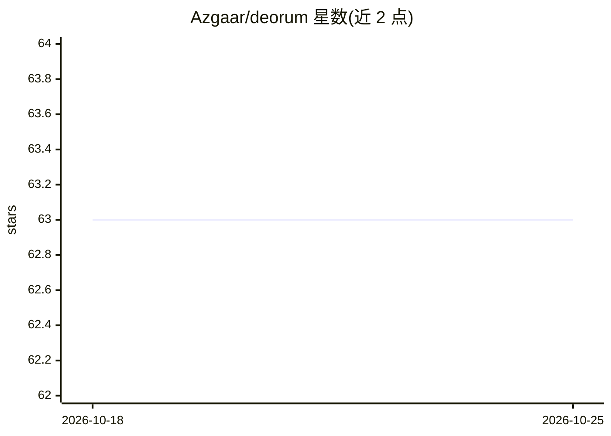

# Azgaar/deorum

⭐ 63 · Svelte · MIT · 推送 2026-03-27 · [GitHub](https://github.com/Azgaar/deorum) · [官网](https://deorum.vercel.app) · 个人维护

**D&D 与世界观构建项目的可定制奇幻角色图库**

由 Azgaar 及贡献者维护的 Web 应用（SvelteKit 构建，Pocketbase 数据库），面向龙与地下城玩家和世界观构建者，提供可定制的奇幻角色素材，并托管于 deorum.vercel.app。项目设有 Discord 与 Reddit 社区供分享作品与反馈， Patreon 提供赞助渠道。开发者可克隆仓库后用 yarn 安装依赖并运行开发服务器进行本地开发，欢迎 Pull Request。README 未说明角色的具体生成机制。

## 筛选速览

| 维度 | 判定 | 备注 |
|---|---|---|
| AI 角色 | `ai-native` | 本体是模型或模型工具 |
| 许可风险 | `permissive` | MIT |
| 部署形态 | `None` |  |
| 模型依赖 | — | README 未给出锁定关系 |
| 硬件要求 | — | 无带数字的原话,不猜 |
| 安装摩擦 | `low` | 无编译、无系统依赖或容器化 |
| 成熟度 | — | 结构信号不足 |

## 能力要点

- 提供面向 D&D 与世界观构建的可定制奇幻角色素材
- SvelteKit + Pocketbase 技术栈，提供在线站点
- 设有 Discord/Reddit 社区与 Patreon 赞助渠道

## 适用场景

- 为 D&D 战役或世界观项目寻找可定制的角色素材
- 在社区中分享自己的角色创作

## 场景标签

`图像生成` · 领域:内容生成

## 证据(README 行号)

> L3: Deorum is a source for customizable fantasy characters for D&D and worldbuilding projects. Created and maintained by

## 星数曲线

2026-10-18 63 → 2026-10-25 63（+0）

---
*卡片 v1 · prompt 1.4 · 生成 2026-10-24 · 置信度 mid · 依据 README sha `7a913a07e408` · [字段定义](../../DATASET.md)*
