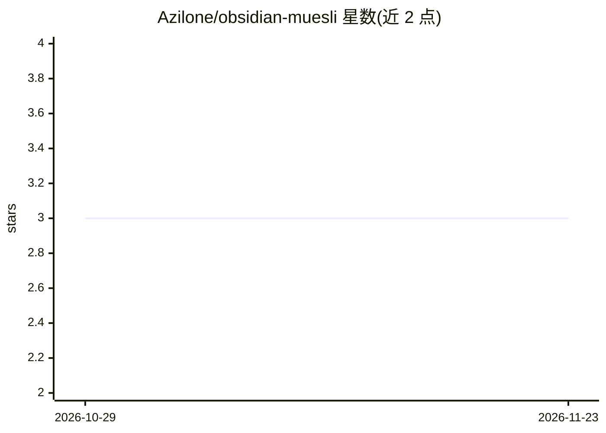

# Azilone/obsidian-muesli

⭐ 3 · TypeScript · MIT · 推送 2026-10-18 · [GitHub](https://github.com/Azilone/obsidian-muesli) · 个人维护

**面向会议密集用户的 Obsidian AI 会议笔记插件**

Obsidian 社区插件：录制任意通话或现场会议，无需机器人加入，在库内生成 Markdown 会议文件夹，含摘要、行动项、带时间戳和说话人分离的转录及原始笔记。转录与摘要通过用户自己的 OpenRouter API key 调用云端模型完成，会议期间边录边转录；提供语音日志、导入已有录音、iPhone 语音备忘录自动归档、自定义模板与英法语摘要。macOS 支持麦克风+系统音频，Windows/Linux 目前仅麦克风。

## 筛选速览

| 维度 | 判定 | 备注 |
|---|---|---|
| AI 角色 | `ai-native` | 本体是模型或模型工具 |
| 许可风险 | `permissive` | MIT |
| 部署形态 | `None` |  |
| 模型依赖 | locked-api |  |
| 硬件要求 | — | 无带数字的原话,不猜 |
| 安装摩擦 | `low` | 无编译、无系统依赖或容器化 |
| 成熟度 | — | 结构信号不足 |

## 能力要点

- 无机器人入会，系统音频经 Core Audio process taps 捕获
- 会议期间后台转录，带说话人分离与时间戳
- 行动项以 Markdown 任务格式输出，兼容 Tasks/Dataview
- 原始文件先写入库内，失败可重新处理

## 适用场景

- 连续开会时自动在 Obsidian 库内归档会议纪要
- 导入录音文件批量生成转录与摘要
- 语音口述任务与计划写入每日笔记

## 场景标签

`语音识别` · 领域:感知与多模态

## 证据(README 行号)

> L26:   Summary.md      ← TL;DR, decisions, actions, open questions
> L91: |**Transcription**|`microsoft/mai-transcribe-2` through OpenRouter, with speaker diarization, in the background *du
> L92: |**Clean-up and summary**|`anthropic/claude-haiku-5.5` by default (any OpenRouter model works): matches speakers, f

## 星数曲线

2026-10-29 3 → 2026-11-23 3（+0）

---
*卡片 v1 · prompt 1.4 · 生成 2026-11-22 · 置信度 high · 依据 README sha `e06750ade2dd` · [字段定义](../../DATASET.md)*
