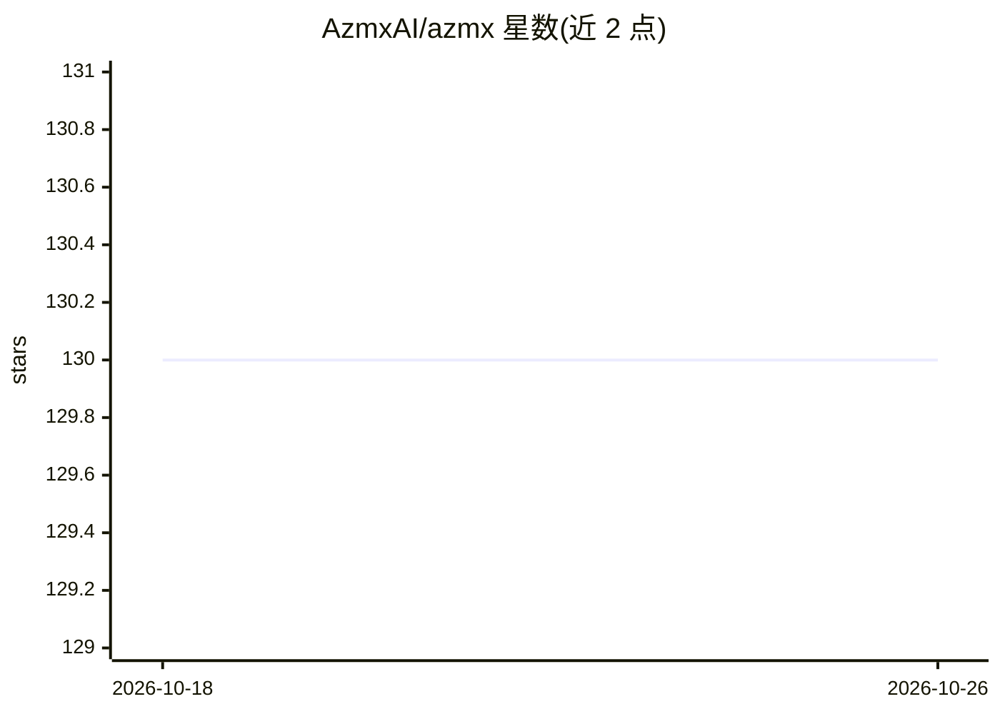

# AzmxAI/azmx

⭐ 130 · TypeScript · NOASSERTION · 推送 2026-06-22 · [GitHub](https://github.com/AzmxAI/azmx) · [官网](https://azmx.ai) · 组织维护

**本地优先的 AI 终端/Agent 桌面应用，BYOK 或本地模型直连**

面向开发者的原生桌面应用（非 Electron，约 10MB 安装包），提供 xterm.js 终端、CodeMirror 编辑器（vim 模式 + AI 补全）与文件树，内置可审批的 AI Agent。模型接入两条路径：一键安装 Ollama 并拉取 Qwen2.5-Coder 等本地模型，或 BYOK 直连 OpenAI、Anthropic、Google、Groq、DeepSeek、Azure 等服务商，请求不经厂商服务器中转。Agent 写文件/执行 shell 前需逐次批准，工具调用记录于本地哈希链审计日志；内置 17 个 MCP 服务器目录。注意：应用本体源码闭源，本仓库发布安装产物与社区贡献面（skills/agents/MCP/snippets），另有 MIT 协议的 MCP server 与 agent-sdk 两个 npm 包。免费/Pro/Teams/Enterprise 分层，部分功能属付费档。

## 筛选速览

| 维度 | 判定 | 备注 |
|---|---|---|
| AI 角色 | `ai-native` | 本体是模型或模型工具 |
| 许可风险 | `none` | NOASSERTION |
| 部署形态 | `desktop` | 安装包/桌面程序 |
| 模型依赖 | local-ok | 支持本地模型 |
| 硬件要求 | — | 无带数字的原话,不猜 |
| 安装摩擦 | `low` | 无编译、无系统依赖或容器化 |
| 成熟度 | — | 结构信号不足 |

## 能力要点

- 一键 Ollama 本地模型安装（默认 Qwen2.5-Coder 7B，Apache 2.0），无需 API key
- BYOK 直连 OpenAI/Anthropic/Google/Groq/DeepSeek/Azure 等，可随时切换
- Agent 每次写文件/执行命令前需批准，工具调用写入本地哈希链审计日志
- 17 个精选 MCP 服务器目录（GitHub/Kubernetes/Postgres 等），一个 JSON 文件即可自加

## 适用场景

- 在本地终端里用 AI Agent 辅助编码与执行命令，且代码不出设备
- 自带 API key 接入多家模型服务商，随时切换
- 对 Agent 的每个文件写入/shell 命令做逐次审批与审计
- 通过 Markdown 单文件扩展技能、子 Agent 与 MCP 连接器

## 场景标签

`编码 Agent` · 领域:编码与开发

## 证据(README 行号)

> L37: - **Your code stays on your machine.** AZMX never proxies AI requests through our servers. Your prompts go directly
> L42: - **Real terminal, real editor, real file explorer.** xterm.js terminal, CodeMirror editor with vim mode + inline A
> L51: 2. The first-run tour appears. On step **"Free local AI"**, click **Set up local AI**.

## 星数曲线

2026-10-18 130 → 2026-10-26 130（+0）

---
*卡片 v1 · prompt 1.4 · 生成 2026-10-22 · 置信度 mid · 依据 README sha `d5a64326b330` · [字段定义](../../DATASET.md)*
