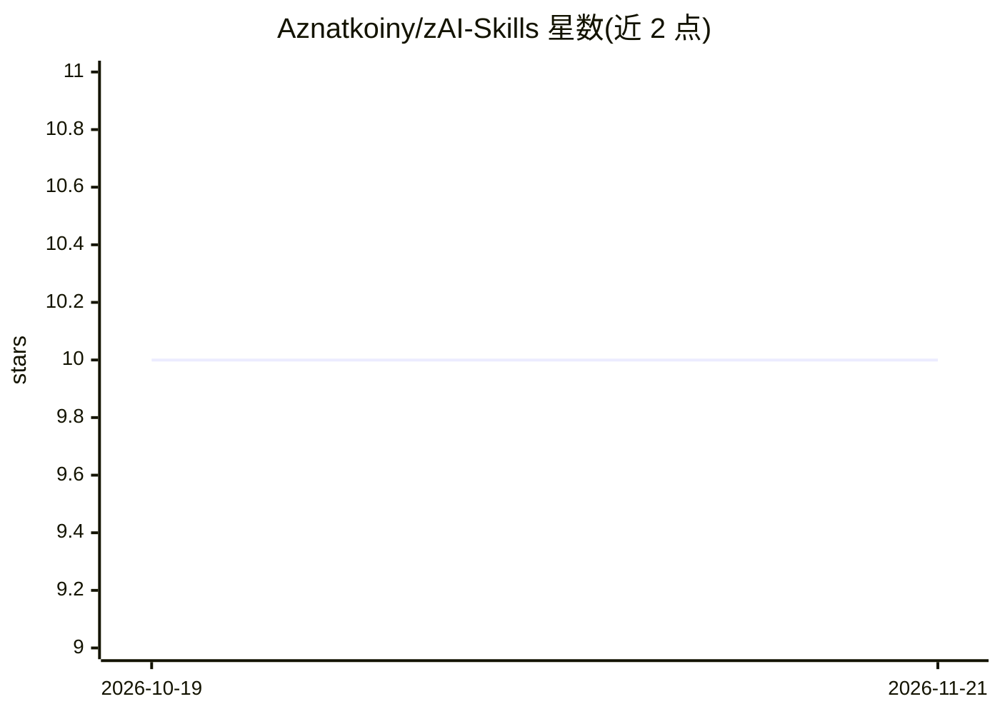

# Aznatkoiny/zAI-Skills

⭐ 10 · Python · MIT · 推送 2026-11-07 · [GitHub](https://github.com/Aznatkoiny/zAI-Skills) · 个人维护

**面向 Claude Code 用户的五插件市场：提示词/RL/咨询/房产/求职**

一个 Claude Code 插件市场仓库，聚合五个插件：ai-toolkit（提示工程、强化学习、深度学习技能与命令）、consulting-toolkit（17 个斜杠命令、咨询框架与金融数据 MCP 服务器）、real-estate-investment（房产交易分析与 13 工具数据服务器）、career-coach（求职流程与招聘数据 MCP 服务器）、plugin-forge（评测优先的插件构建器，托管于独立仓库）。通过 /plugin marketplace add 安装，支持 macOS/Linux，Windows 需 WSL。API key 均为可选。

## 筛选速览

| 维度 | 判定 | 备注 |
|---|---|---|
| AI 角色 | `ai-ecosystem` | LLM/agent 周边工具 |
| 许可风险 | `permissive` | MIT |
| 部署形态 | `library` | 以包/库形式分发 |
| 模型依赖 | — | README 未给出锁定关系 |
| 硬件要求 | — | 无带数字的原话,不猜 |
| 安装摩擦 | `low` | 无编译、无系统依赖或容器化 |
| 成熟度 | — | 结构信号不足 |

## 能力要点

- 五个插件覆盖提示工程、强化学习、咨询交付、房产投资分析与求职辅导
- 三个 MCP 数据服务器：金融情报（SEC EDGAR/FRED/Yahoo Finance）、房产数据（7 来源 13 工具）、招聘信息（多招聘板与薪酬数据）
- 通过 /plugin marketplace add 一行命令安装市场，插件内含 skills、commands、agents、hooks
- plugin-forge 采用评测套件作为契约的测试优先开发方式

## 适用场景

- 为 Claude 模型编写或优化提示词、搭建强化学习训练项目
- 生成带来源引用的咨询交付物（议题树、市场规模、商业案例）
- 分析租赁或商业地产交易、筛选房源、比较市场
- 从简历建立求职档案并生成定制简历与模拟面试

## 场景标签

`提示工程` `模型评测` `金融量化` `强化学习` · 领域:Agent 开发

## 证据(README 行号)

> L3: A Claude Code plugin marketplace with five plugins: four maintained here and one (plugin-forge) hosted in its own re
> L15: ## Install

## 星数曲线

2026-10-19 10 → 2026-11-21 10（+0）

---
*卡片 v1 · prompt 1.4 · 生成 2026-11-20 · 置信度 high · 依据 README sha `9c2a178f17e0` · [字段定义](../../DATASET.md)*
