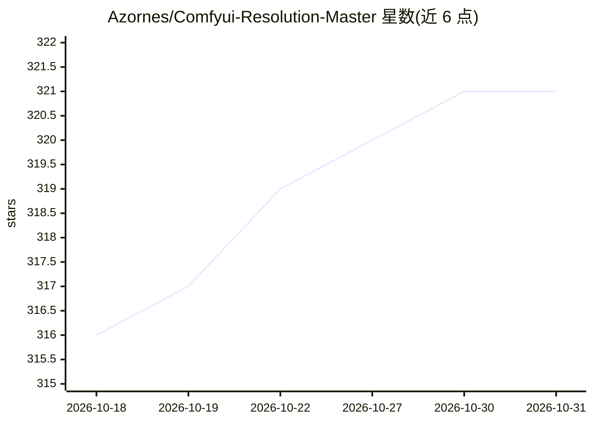

# Azornes/Comfyui-Resolution-Master

⭐ 321 · JavaScript · MIT · 推送 2026-10-17 · [GitHub](https://github.com/Azornes/Comfyui-Resolution-Master) · 个人维护

**ComfyUI 自定义节点：精确控制生成分辨率与宽高比**

面向 ComfyUI 用户的分辨率与宽高比控制自定义节点：提供可拖拽的交互式 2D 画布、手动倍率/目标分辨率/兆像素三种缩放模式、按类别组织的预设库（Standard、SDXL、Flux/Flux.2、WAN、HiDream、Qwen-Image、ZImageTurbo、社交媒体、印刷、电影等），并对各模型实施特定优化规则（如 SDXL 固定官方分辨率、Flux 32px 增量与 4.0 MP 上限）。节点本身不处理图像，仅输出 width/height/rescale_factor 供下游节点使用。支持 ComfyUI-Manager 一键安装或 git clone 手动安装，需 Python 3.10+。

## 筛选速览

| 维度 | 判定 | 备注 |
|---|---|---|
| AI 角色 | `ai-ecosystem` | LLM/agent 周边工具 |
| 许可风险 | `permissive` | MIT |
| 部署形态 | `None` |  |
| 模型依赖 | — | README 未给出锁定关系 |
| 硬件要求 | — | 无带数字的原话,不猜 |
| 安装摩擦 | `low` | 无编译、无系统依赖或容器化 |
| 成熟度 | — | 结构信号不足 |

## 能力要点

- 交互式 2D 画布可视选择分辨率（Shift 保持宽高比、Ctrl 精细调整）
- 按模型实施优化规则：SDXL/Flux/Flux.2/WAN/Krea 2/HiDream/Qwen-Image/ZImageTurbo
- Auto-Detect 自动读取输入图像尺寸，配合 Auto-fit/Auto-Resize/Auto-Snap 自动适配
- 自定义预设管理与模型 profile 扩展机制（js/calculations/model_profiles.js）

## 适用场景

- 为 SDXL/Flux/WAN 等模型选择官方支持的分辨率
- 把输入图像尺寸自动适配到社交媒体、印刷或视频规格
- 在放大工作流中获取 rescale_factor 缩放系数

## 场景标签

`图像生成` · 领域:内容生成

## 证据(README 行号)

> L1: ResolutionMaster – Precise resolution and aspect ratio control for ComfyUI
> L3:  ResolutionMaster is a powerful ComfyUI custom node for precise resolution and aspect ratio control in AI image gene
> L93: ### Install via ComfyUI-Manager

## 星数曲线

2026-10-18 316 → 2026-10-31 321（+5）

---
*卡片 v1 · prompt 1.4 · 生成 2026-10-21 · 置信度 high · 依据 README sha `64af99b6f23c` · [字段定义](../../DATASET.md)*
