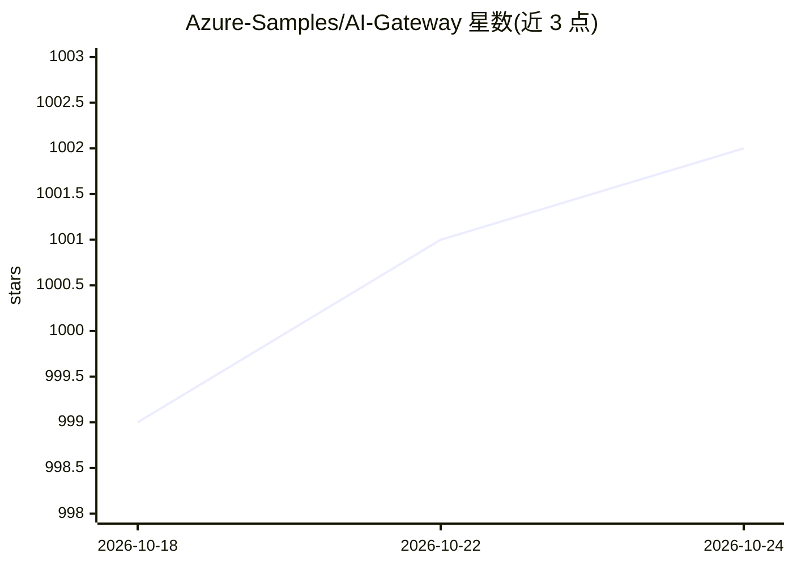

# Azure-Samples/AI-Gateway

⭐ 1,002 · Jupyter Notebook · MIT · 推送 2026-09-16 · [GitHub](https://github.com/Azure-Samples/AI-Gateway) · [官网](https://aka.ms/ai-gateway/labs) · 组织维护

**基于 Azure API Management 的企业级 AI 网关实验室合集**

微软 Azure-Samples 维护的开源实验室仓库，演示如何用 Azure API Management 与 Microsoft Foundry 搭建企业级 AI 网关：对模型访问提供负载均衡、令牌限流、语义缓存、多模型路由；对工具提供 MCP 协议支持与函数调用；对 Agent 提供 OpenAI Agents SDK、Gemini MCP、A2A 等编排实验。每个 lab 为 Jupyter notebook 加 Bicep 模板与 APIM 策略，可部署到 Azure 订阅，需 Python 3.12+、uv、Azure CLI 与相应 RBAC 角色；另含开发测试工具与 Copilot Agent Skills 辅助创建新 lab。

## 筛选速览

| 维度 | 判定 | 备注 |
|---|---|---|
| AI 角色 | `ai-ecosystem` | LLM/agent 周边工具 |
| 许可风险 | `permissive` | MIT |
| 部署形态 | `None` |  |
| 模型依赖 | locked-api |  |
| 硬件要求 | — | 无带数字的原话,不猜 |
| 安装摩擦 | `low` | 无编译、无系统依赖或容器化 |
| 成熟度 | — | 结构信号不足 |

## 能力要点

- 30+ 个 hands-on lab，覆盖模型、工具（MCP）、Agent 三类网关场景
- 安全（OAuth 2.0、内容安全）、可观测（令牌指标）、成本控制（FinOps）策略演示
- 提供 Bicep/Terraform 生成、MCP server 构建等 Copilot Agent Skills
- 附开发工具集：追踪、流式测试、限流测试、OpenAI API mock server

## 适用场景

- 企业为 LLM 流量引入网关做安全、限流与成本治理
- 学习 MCP 协议与函数调用在 API Management 中的落地
- 构建与管控多模型、多 Agent 的生产级架构

## 场景标签

`模型网关` · 领域:Agent 开发

## 证据(README 行号)

> L8: ### Explore the enterprise-grade gateway for managing AI Models, Tools, and Agents
> L20: **AI Gateway** powered by Azure API Management provides:
> L32: Each lab is a hands-on Jupyter notebook with step-by-step instructions, Bicep infrastructure templates, and APIM po

## 星数曲线

2026-10-18 999 → 2026-10-24 1,002（+3）

---
*卡片 v1 · prompt 1.4 · 生成 2026-10-21 · 置信度 high · 依据 README sha `ff93f5cbdeb5` · [字段定义](../../DATASET.md)*
