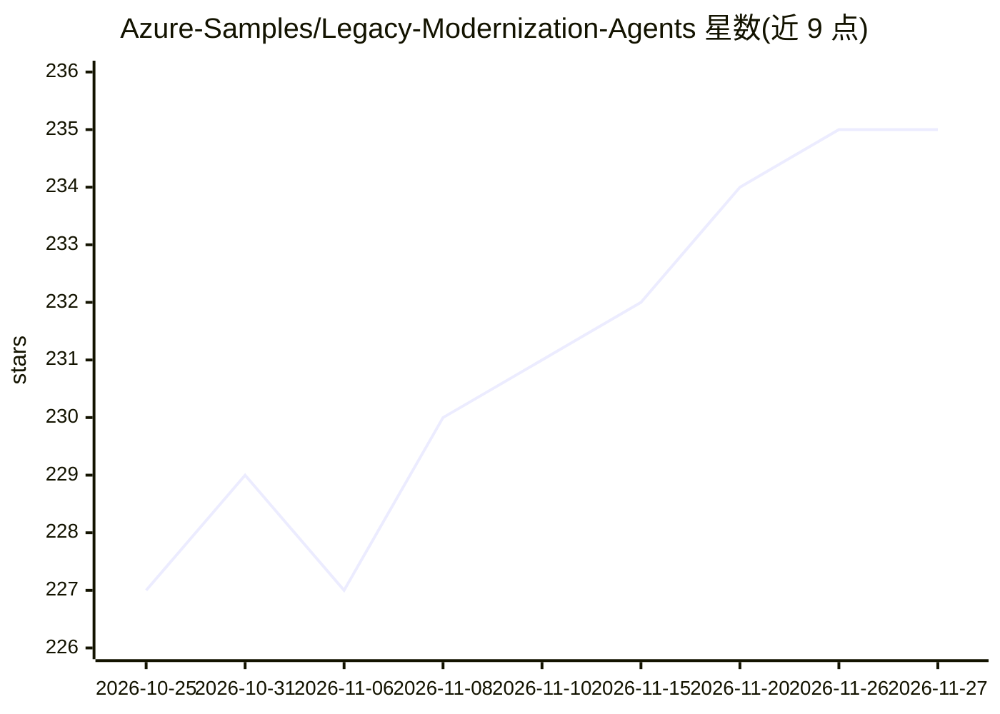

# Azure-Samples/Legacy-Modernization-Agents

⭐ 235 · C# · MIT · 推送 2026-11-25 · [GitHub](https://github.com/Azure-Samples/Legacy-Modernization-Agents) · 组织维护

**用 AI Agent 把 COBOL 主机代码迁移到 Java/C# 的开源框架**

基于 Microsoft Agent Framework 的迁移框架，面向需要改造遗留主机系统的团队：先用无模型调用的 REKT 解析器解析 COBOL/CICS/JCL 并将结构载入 Neo4j，再由多个可编辑 persona 的 Agent（分析、业务逻辑逆向、Java/C# 转换、依赖映射）完成逆向工程与代码转换，支持 Quarkus 或 Spring 目标框架，产出迁移报告与编译状态。通过 doctor.sh 脚本编排流程，附带 Web 门户展示资产全景、AST 与转换过程。

## 筛选速览

| 维度 | 判定 | 备注 |
|---|---|---|
| AI 角色 | `ai-native` | 本体是模型或模型工具 |
| 许可风险 | `permissive` | MIT |
| 部署形态 | `self-host` | docker 或自建部署 |
| 模型依赖 | locked-api |  |
| 硬件要求 | — | 无带数字的原话,不猜 |
| 安装摩擦 | `low` | 无编译、无系统依赖或容器化 |
| 成熟度 | — | 结构信号不足 |

## 能力要点

- 多 Provider 架构：Azure OpenAI、GitHub Copilot SDK、直连 OpenAI
- REKT 解析 + Neo4j 图谱步骤无模型调用，无需 AI 登录
- Agent prompt 为 Markdown 文件可编辑，另提供 Prompt Studio 生成与评分
- 支持按程序、调用闭包或 JCL 任务粒度选择性转换

## 适用场景

- 把 COBOL/CICS 遗留系统批量转换为 Java 或 C# .NET
- 转换前解析并核查 AST 覆盖缺口，评估可迁移性
- 生成业务规则与术语的逆向工程报告供团队阅读
- 从 JCL 任务出发规划迁移切片与波次

## 场景标签

`编码 Agent` · 领域:编码与开发

## 证据(README 行号)

> L7: This open source migration framework was developed to demonstrate AI Agents capabilities for converting legacy code 
> L8: The migration uses Microsoft Agent Framework with a multi-provider architecture supporting **Azure OpenAI** (Respons
> L41: |**.NET SDK**|10.0+|Download|

## 星数曲线

2026-10-25 227 → 2026-11-27 235（+8）

---
*卡片 v1 · prompt 1.4 · 生成 2026-11-25 · 置信度 mid · 依据 README sha `3b4879c792b8` · [字段定义](../../DATASET.md)*
