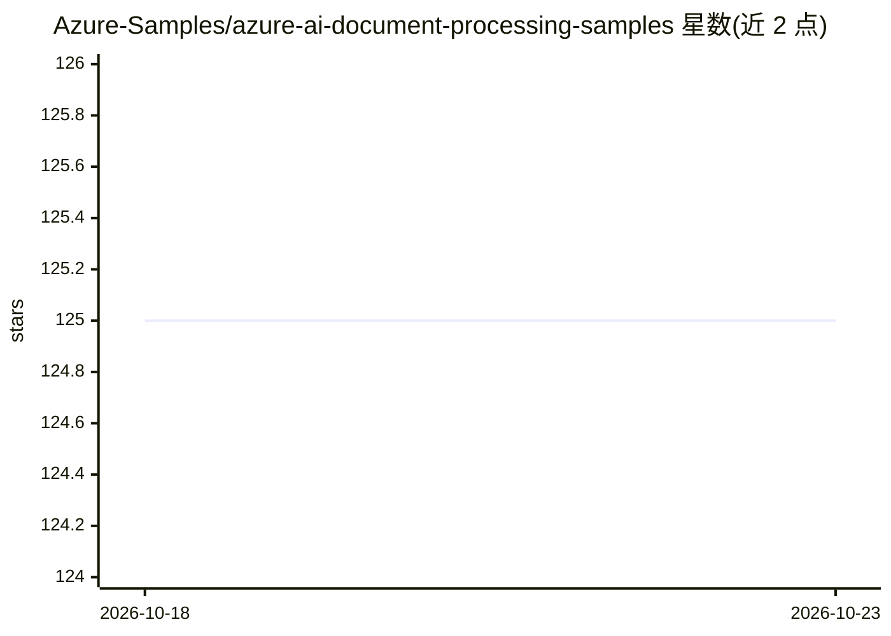

# Azure-Samples/azure-ai-document-processing-samples

⭐ 125 · Bicep · MIT · 推送 2025-10-27 · [GitHub](https://github.com/Azure-Samples/azure-ai-document-processing-samples) · [官网](https://aka.ms/azure-ai-document-extraction) · 组织维护

**Azure AI 文档处理示例集：分类/抽取/脱敏的参考代码**

微软 Azure-Samples 维护的代码示例集合，演示用 Azure AI Foundry、Azure OpenAI（GPT-4.1、Phi-4）、Azure AI Document Intelligence、Azure AI Language 等服务构建文档处理方案：基于视觉/嵌入的文档分类、LLM 与 PII 分析的敏感信息脱敏、文本与多模态结构化数据抽取（附准确率与置信度评分），并提供发票、美国税表 1040 两个端到端场景。示例以 Python 与 .NET 编写，需 Azure 订阅，通过 Dev Container/Codespaces 运行，部署脚本自动创建 Azure 资源。

## 筛选速览

| 维度 | 判定 | 备注 |
|---|---|---|
| AI 角色 | `ai-knowledge` | 知识聚合/清单类 |
| 许可风险 | `permissive` | MIT |
| 部署形态 | `None` |  |
| 模型依赖 | locked-api |  |
| 硬件要求 | — | 无带数字的原话,不猜 |
| 安装摩擦 | `low` | 无编译、无系统依赖或容器化 |
| 成熟度 | — | 结构信号不足 |

## 能力要点

- 文档分类/脱敏/结构化抽取三类示例，含准确率与置信度评分
- 发票与美国税表 1040 两个端到端组合场景
- 提供 Dev Container 与 bicep/PowerShell 一键部署脚本
- Python 与 .NET 双语言版本

## 适用场景

- 我在构建发票/表单等文档的结构化数据抽取方案，需要参考实现
- 我需要按上下文规则对文档做敏感信息脱敏
- 我想了解如何组合 Azure 多个 AI 服务完成文档分类与抽取

## 场景标签

`文档解析` · 领域:知识与检索

## 证据(README 行号)

> L20: This repository contains a collection of code samples that demonstrate how to use various Azure AI capabilities to 
> L22: The samples are intended to help engineering teams establish techniques with Azure AI Foundry, Azure OpenAI, Azure 

## 星数曲线

2026-10-18 125 → 2026-10-23 125（+0）

---
*卡片 v1 · prompt 1.4 · 生成 2026-10-23 · 置信度 high · 依据 README sha `9f37b90d2062` · [字段定义](../../DATASET.md)*
