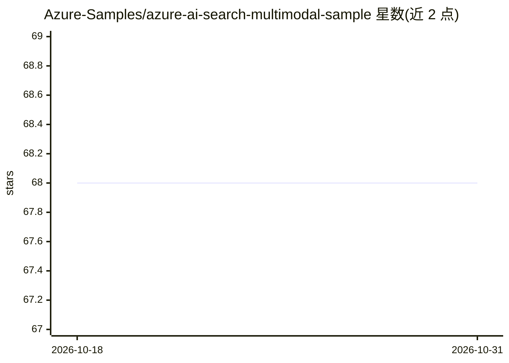

# Azure-Samples/azure-ai-search-multimodal-sample

⭐ 68 · Python · MIT · 推送 2026-10-28 · [GitHub](https://github.com/Azure-Samples/azure-ai-search-multimodal-sample) · 组织维护

**Azure 上的多模态 RAG 问答示例应用**

微软 Azure-Samples 提供的示例应用：基于 Azure AI Search 做检索、Azure OpenAI 模型做 LLM verbalization 与 RAG 编排，支持对 PDF 文档（含图像）做索引与问答。提供两种索引策略（indexer-image-verbal、self-multimodal-embedding），通过 azd 一键部署到 Azure App Service，也可在 Windows/Linux 本地运行；本地需 Python、Node.js、az cli、azd、PowerShell 7。部署需 Azure 账户与 RBAC 权限，使用多项计费的 Azure 服务。

## 筛选速览

| 维度 | 判定 | 备注 |
|---|---|---|
| AI 角色 | `ai-native` | 本体是模型或模型工具 |
| 许可风险 | `permissive` | MIT |
| 部署形态 | `None` |  |
| 模型依赖 | locked-api |  |
| 硬件要求 | — | 无带数字的原话,不猜 |
| 安装摩擦 | `low` | 无编译、无系统依赖或容器化 |
| 成熟度 | — | 结构信号不足 |

## 能力要点

- 多模态 RAG 模式：Azure AI Search 检索 + Azure OpenAI 模型 verbalization
- 支持自带 PDF 数据索引，两种索引策略可选
- azd up 一键预配资源、注入数据并部署到 App Service
- 支持 GitHub Codespaces、Windows/Linux 本地运行

## 适用场景

- 在 Azure 上搭建图文混合文档的问答体验
- 参考多模态 RAG 架构的实现与部署方式
- 用自带 PDF 数据替换演示数据构建索引

## 场景标签

`RAG` `多模态` `文档问答` · 领域:知识与检索

## 证据(README 行号)

> L105: 1. **Azure AI Search**
> L112:  - **LLM Deployment**: For running the large language model (LLM) for verbalization and used by the RAG orchestrat
> L113:  - **Embedding Model Deployment**: Used for creating embeddings for vector search and other tasks.

## 星数曲线

2026-10-18 68 → 2026-10-31 68（+0）

---
*卡片 v1 · prompt 1.4 · 生成 2026-10-24 · 置信度 high · 依据 README sha `455771efe540` · [字段定义](../../DATASET.md)*
